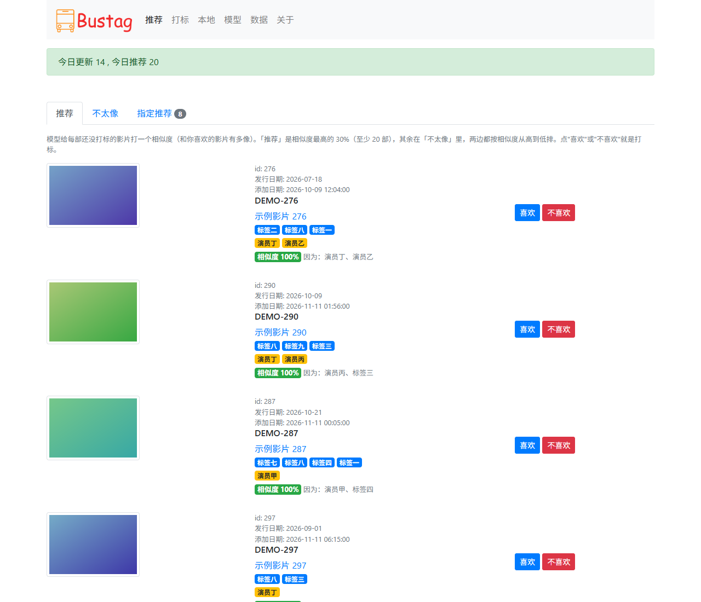
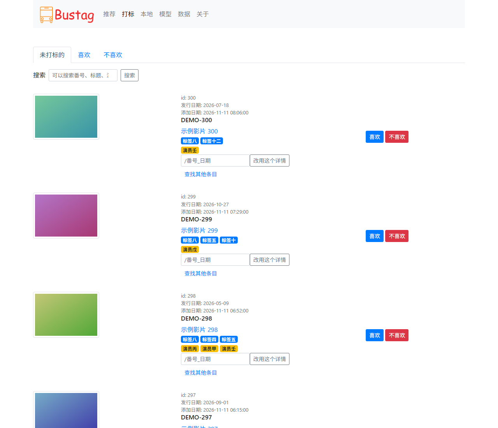
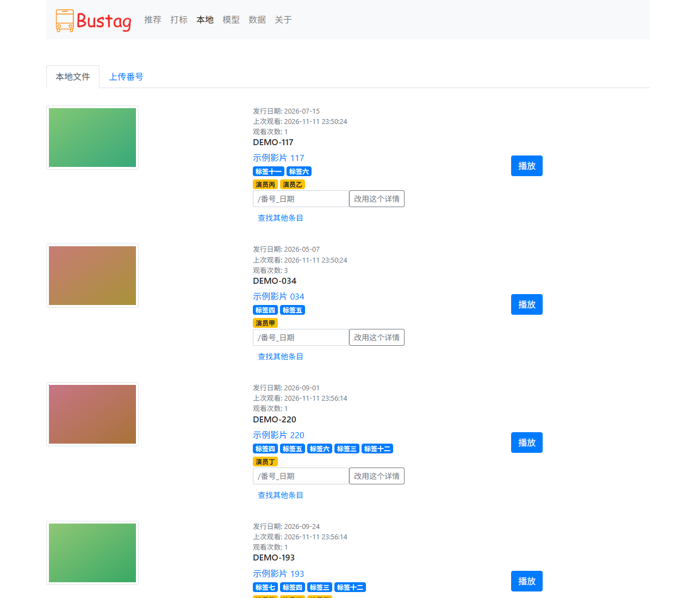
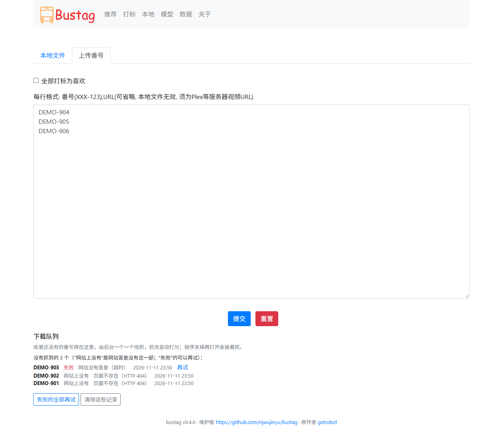
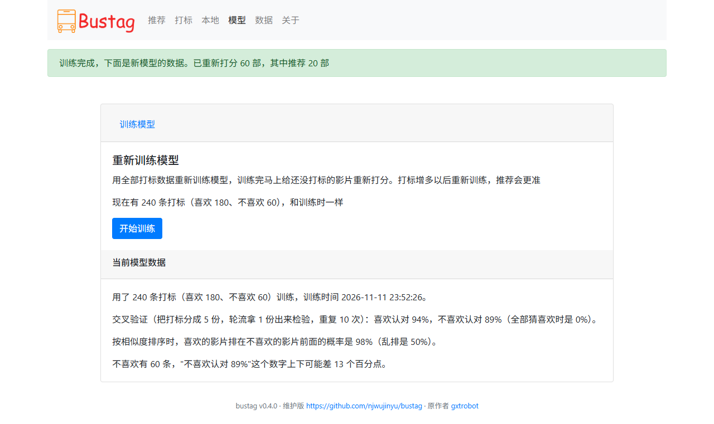
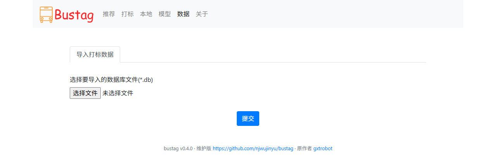

# Bustag（维护版）


给 JavBus 影片打标、训练模型并自动推荐的小工具。原理：定时抓取最新的影片信息，你对影片点"喜欢"或"不喜欢"；打标到一定数量后训练一个 KNN 模型，之后每次抓到新影片都会自动预测你是否喜欢，可以先看推荐、跳过大量不喜欢的影片，节约时间。

## 关于这个版本

- 原作者 [gxtrobot](https://github.com/gxtrobot/bustag) 在 2019-10 发布 0.2.1 后停止了维护，原版的爬虫框架（aspider）、依赖版本、网站域名、封面图床和 Docker 镜像都已失效，今天装不上也跑不起来。
- 本仓库（[njwujinyu/bustag](https://github.com/njwujinyu/bustag)）是 fork 之后的维护版，**只修不加功能**：重写爬虫、封面改为程序代取、更新依赖和 Docker 镜像；另外新增了 Windows exe 和自检命令 `check`。数据库表结构没有变，0.2.x 的 `bus.db` 可以直接用。
- 感谢原作者 gxtrobot 的创作，许可证（MIT）保持不变，见 [LICENSE](./LICENSE)。
- 问题请到本仓库的 [Issues](https://github.com/njwujinyu/bustag/issues) 反馈。

**免责声明：本软件仅用于技术学习使用，禁止用于商业用途，使用本软件所造成的后果由使用者承担！**

## 系统功能

- 自动抓取最新影片信息（启动后约 5 秒抓一次，之后按 `interval` 间隔抓取）
- 影片打标（喜欢 / 不喜欢），封面由程序代取并缓存
- 基于全部打标数据训练模型；有了模型后，每次抓取完自动对未打标的新影片预测并推荐
- 手动上传番号、登记本地文件（或 Plex 等服务器上的视频链接）
- 导入别人的 / 旧版本的打标数据库
- Windows 双击运行的 exe，Docker 镜像（linux/amd64 和 linux/arm64，适合 NAS 和服务器）

## 系统截图（隐藏了左边封面图片）

- 推荐页面
  

- 打标页面
  

- 本地文件页面
  

- 本地番号、链接上传页面
  

- 模型页面
  

- 数据页面
  

## 如何运行

启动后在浏览器打开 `http://127.0.0.1:8000`（程序会在日志里打印这个地址）。同一局域网里的其他设备用 `http://<这台机器的 IP>:8000`。

> 程序没有登录功能，只适合在自己的局域网里用，**不要把 8000 端口映射到公网**。

### Windows（exe，不用装 Python）

1. 到本仓库的 [Releases](https://github.com/njwujinyu/bustag/releases) 页面下载 `bustag-<版本>-windows-x64.zip`。每次推送代码的构建也能在 [Actions](https://github.com/njwujinyu/bustag/actions) 里对应的运行页底部下载（需要登录 GitHub）。
2. 解压到任意目录（不要放在 `C:\Program Files` 这类需要管理员权限的位置，程序要在 exe 旁边写 `data` 目录）。
3. 双击 `bustag\bustag.exe`。会出现一个黑色的控制台窗口，里面是运行日志，**关掉窗口程序就退出了**。
4. 浏览器打开 `http://127.0.0.1:8000`。

说明：

- 数据（数据库、配置、模型、封面缓存）放在 exe 旁边的 `data` 文件夹。升级时把新版解压到新目录，再把旧目录里的 `data` 文件夹复制过去。
- 第一次启动较慢（本机实测约 19 秒，杀毒软件会扫描解压出来的上千个文件），之后 2–3 秒。exe 没有数字签名，Windows 可能弹出"已保护你的电脑"，点"更多信息 → 仍要运行"。
- 端口被占用时窗口里会提示，在命令行里设置 `BUSTAG_PORT` 换一个端口：PowerShell 里 `$env:BUSTAG_PORT = '8001'; .\bustag.exe`，cmd 里 `set BUSTAG_PORT=8001` 后再运行。
- exe 里只有网页服务；`check`、`download` 等命令行工具要用源码运行（见下）。

### Docker（NAS / 服务器，推荐）

镜像是 `ghcr.io/njwujinyu/bustag`，支持 linux/amd64 和 linux/arm64，由 GitHub Actions 构建并推送。

```bash
mkdir bustag && cd bustag
# 把本仓库的 docker-compose.yml 放进来，然后：
docker compose up -d
```

或者直接用 `docker run`：

```bash
# Linux / macOS
docker run -d --name bustag --restart unless-stopped -p 8000:8000 -v "$(pwd)/data:/app/data" ghcr.io/njwujinyu/bustag:latest
# Windows PowerShell
docker run -d --name bustag --restart unless-stopped -p 8000:8000 -v "${PWD}/data:/app/data" ghcr.io/njwujinyu/bustag:latest
```

- `data` 目录保存数据库、配置、模型和封面缓存，**一定要挂载**，否则删除容器就丢数据。第一次启动会自动生成 `data/config.ini`。
- 镜像标签：`latest`（默认分支 / 最新版本）、`0.3.0`、`0.3`（版本号）、`revive` 这样的分支名。
- 时区默认 `Asia/Shanghai`（"今日更新"按这个时区算），要改就设置环境变量 `TZ`。
- 8000 被占用时改映射的主机端口，例如 `-p 8080:8000`，然后访问 `http://127.0.0.1:8080`。
- 更新：`docker compose pull && docker compose up -d`。看日志：`docker logs -f bustag`。自检：`docker exec -it bustag python -m bustag.main check`。
- 要走代理时在 `data/config.ini` 里写 `proxy`；注意容器里的 `127.0.0.1` 是容器自己，代理在宿主机上就要写宿主机的局域网 IP。

**关于 ghcr.io 镜像的可见性**

GitHub 规定，新发布的容器镜像包**默认是私有的**，此时 `docker pull` 会报 `unauthorized` 或 `denied`。有两种办法：

1. 仓库主人把包改成公开：GitHub 里进入自己的个人主页 → **Packages** 标签 → 点开 `bustag` → 右侧 **Package settings** → 页面最下面 **Danger Zone** → **Change visibility** → 选 **Public** → 输入包名确认。注意公开之后不能再改回私有。第一次工作流成功推送之后才会出现这个包。
2. 保持私有，在要拉镜像的机器上先登录：到 GitHub 的 Settings → Developer settings → Personal access tokens (classic) 创建一个只勾选 `read:packages` 的令牌，然后

   ```bash
   echo <令牌> | docker login ghcr.io -u <GitHub 用户名> --password-stdin
   ```

   再 `docker pull` 或 `docker compose up -d`。

### 从源码运行

需要 Python 3.11 – 3.14。

```bash
git clone https://github.com/njwujinyu/bustag.git
cd bustag
python -m venv .venv
.venv\Scripts\activate          # Linux / macOS：source .venv/bin/activate
pip install -r requirements.txt
python -m bustag.app.index      # 也可以 python bustag/app/index.py
```

数据放在当前目录下的 `data/`（可以用 `BUSTAG_DATA_DIR` 指定别处）。

用 gunicorn 运行时 `-w` **只能是 1**（定时抓取任务在进程内，多个 worker 会各抓一份），请求用 `--threads` 开多个线程处理（数字可以调）：

```bash
pip install gunicorn
gunicorn -w 1 --threads 8 "bustag.app.index:create_app()" --bind 0.0.0.0:8000
```

不要去掉 `--threads`：不带它时 gunicorn 一次只处理一个请求，下载封面期间整个网站都在排队，单个请求超过 30 秒还会被 gunicorn 重启（连同正在运行的抓取）。

也可以 `pip install .` 之后用 `bustag check`、`bustag download`、`bustag recommend`，作用和下面的 `python -m bustag.main …` 一样。

## 如何使用

按下面的顺序：

1. 打开 **打标** 页，"未打标的"里是新抓到的影片，逐个点"喜欢"或"不喜欢"。打标至少 200 条，并且"喜欢"和"不喜欢"都要有（每种至少 2 条）；建议 300 条以上，越多效果越好。
2. 打开 **模型** 页，点"开始训练"，训练完回到模型页，显示准确率、覆盖率和综合评分。训练成功、保存好之后才替换原来的模型；训练失败（比如打标不够）或者保存失败（比如磁盘满）时按钮下面用红字写明原因，"当前模型数据"里仍是原来正在使用的模型（推荐照常用它）。
3. 之后每次定时抓取结束，程序会自动对新抓到的、还没打标的影片预测，结果出现在 **推荐** 页（"喜欢"和"不喜欢"两个标签页，页面上方显示今日更新和今日推荐的数量）。
4. 在推荐页对每部影片点"正确"或"错误"来确认。确认过的影片会变成你的打标数据（点"错误"会把预测反过来记）。每部影片只记第一次的选择：重复点、在旧页面上再点都不会改掉它，要改就到打标页的"喜欢 / 不喜欢"标签页里改。
5. 积累了更多打标数据后，回 **模型** 页重新训练。

其他页面：

- **本地**：登记过本地文件或视频链接的影片，点"播放"按钮会跳转到登记的链接（只支持 http / https 地址，例如 Plex 里的播放地址）。影片信息还没下载到的本地文件（正在下载，或者番号不存在、下载失败）暂不列出，页面上会写明还有几个。
  - **上传番号** 标签页里每行写 `番号` 或 `番号,链接`（链接里可以有逗号），一次最多提交 10 MB（约十万行）。番号不区分大小写，`300MIUM-1506`、`T28-123`、`[FHD]SSIS-001.mp4` 这类写法都能认出来，不带横线的 `abp001` 记成 `ABP-001`。
  - 勾选"全部打标为喜欢"可以批量打标：已经有系统推荐的影片改成你的打标，你自己打过标的保持不变。库里还没有的番号会加入下载队列。
- **数据**：导入另一个 bustag 的 `bus.db` 里的用户打标（0.2.x 以前的旧格式也支持）。番号统一成大写，番号不合法或评分不是"喜欢 / 不喜欢"的行跳过；已经有系统推荐的影片改成导入的打标，你自己打过标的保持不变。结果页写明导入了几条（其中几条原来是系统推荐）、几条没有改动、跳过了几条；库里没有的番号会加入下载队列。
- **关于**：免责声明和项目信息。

## 配置

### config.ini

在数据目录里，第一次启动时自动生成（带中文注释），改完需要**重启程序**才生效。

```ini
# bustag 配置文件。首次启动时自动生成，修改后重启程序生效。

[download]
# JavBus 网址。网站换域名时改这里
root_path = https://www.javbus.com
# 每次抓取最多新增多少部影片
count = 100
# 自动抓取的间隔（秒），10800 秒 = 3 小时
interval = 10800
# 高级选项，一般不用改。需要时去掉行首的 # 再修改：
# 两次请求之间的最小间隔（秒）
# delay = 1.5
# 每次抓取最多翻多少页列表
# max_page = 30

[options]
# 代理地址，例如 http://127.0.0.1:7890 或 socks5://127.0.0.1:1080
# 留空表示使用系统或环境变量里的代理设置
proxy =
```

| 配置项 | 默认值 | 说明 |
|---|---|---|
| `download.root_path` | `https://www.javbus.com` | 网站地址，网站换域名时改这里。已知失效的旧域名（`busdmm.work`、`cdnbus.bid`）启动时会在日志里醒目提示，程序不会自动改你的文件 |
| `download.count` | `100` | 每次抓取最多新增多少部影片（不是请求数），整数，至少 1。初次使用想多抓一些可以临时调大，每部约需 2–4 秒；日常 100 以内就够了 |
| `download.interval` | `10800` | 自动抓取的间隔，单位秒（10800 = 3 小时），整数，至少 60，不建议低于 1800 |
| `download.delay` | `1.5` | 两次请求之间的最小间隔，单位秒，可以有小数，至少 0。别调得太小，太频繁容易被网站拦截，也会给网站带来压力 |
| `download.max_page` | `30` | 每次抓取最多翻多少页列表，整数，至少 1 |
| `options.proxy` | 空 | 代理地址，支持 `http://`、`https://`、`socks5://`，例如 `http://127.0.0.1:7890`、`socks5://127.0.0.1:1080`。带用户名密码时写 `http://用户:密码@主机:端口`，密码里的 `%40` 这类转义照原样写；`check` 的输出和日志里密码显示成 `***`。留空表示使用系统 / 环境变量里的代理（`HTTP_PROXY`、`HTTPS_PROXY`、`ALL_PROXY`） |

一次抓取在这些情况下结束：新增够了 `count` 部；翻到了 `max_page` 页；连续 3 页都没有新影片（说明已经追上）；没有下一页；被网站拦截。

`config.ini` 写错时（例如 `interval = 3h`、某一行不是 `键 = 值`、同一个键写了两遍、文件编码认不出来），程序启动时只写一行错误，说明是哪个文件、第几行或哪个值有问题，然后退出（双击运行的 exe 会等你按回车再关窗口）。改好再启动，或者删掉 `config.ini` 让程序重新生成默认配置。数据目录建不了（例如同名的文件占着）时也是这样。

文件编码：程序先按 UTF-8 读（有没有 BOM 都行），读不了再按系统默认编码读。中文 Windows 的系统编码是 GBK，所以用记事本存成 ANSI 也能用；Linux 和 Docker 里系统编码通常就是 UTF-8，只能用 UTF-8。两种都读不了时（例如存成了 UTF-16，记事本里叫"UTF-16 LE"或"Unicode"）报"文件编码无法识别"。程序自己生成的 `config.ini` 是 UTF-8，最省事的做法是一直用 UTF-8 保存。

### 环境变量

| 变量 | 默认值 | 说明 |
|---|---|---|
| `BUSTAG_DATA_DIR` | exe 旁边的 `data`，源码 / Docker 是当前目录下的 `data` | 数据目录，相对路径按当前目录解析，不存在会自动创建 |
| `BUSTAG_HOST` | `0.0.0.0` | 监听地址，只想本机访问时设成 `127.0.0.1` |
| `BUSTAG_PORT` | `8000` | 监听端口（1–65535），Docker 里改了端口还要改 `-p` 映射 |
| `BUSTAG_DEBUG` | 空 | 设成 `1` 输出详细日志（DEBUG） |
| `TZ` | Docker 镜像里是 `Asia/Shanghai` | 时区，影响"今日更新 / 今日推荐" |

### 命令行（源码运行）

```bash
python -m bustag.main check        # 自检，出问题先跑这个
python -m bustag.main download     # 立即抓取一次，--count N 指定最多新增多少部
python -m bustag.main recommend    # 用现有模型对未打标的影片预测
```

`check` 会逐项打印 ✅ / ⚠️ / ❌ 和建议，有关键项失败时退出码为 1：配置（数据目录、`root_path`、代理，代理密码显示成 `***`）→ 连通首页 → 解析影片列表 → 抓一部详情并解析 → 下载它的封面（不写入缓存）→ 数据库里的影片数和打标数、模型文件和标签编码器能不能用（读得出来、两个是同一次训练的，并且试着预测一次；有问题时的提示和网页"模型"页、`recommend` 的一样）。

`recommend` 在还没有训练过模型、模型文件读不了，或者模型和标签编码器对不上、在当前的 scikit-learn 下不能预测时打印原因（不写入任何推荐结果），退出码为 1；没有新影片要推荐时退出码为 0。

### 数据目录

```
data/
├── bus.db                影片、标签和打标数据（SQLite，运行时旁边会有 bus.db-wal 和 bus.db-shm）
├── config.ini            配置文件
├── model/
│   ├── model.pkl         训练好的模型
│   └── label_binarizer.pkl   标签编码器
└── covers/               封面缓存，可以随时删除，用到时会重新下载
```

备份就是关掉程序后复制整个 `data` 目录。`bus.db` 是普通的 SQLite 文件，可以用 [DB Browser for SQLite](https://sqlitebrowser.org/) 之类的软件打开。

## 常见问题

**抓不到数据 / 页面是空的**

先跑自检（源码：`python -m bustag.main check`，Docker：`docker exec -it bustag python -m bustag.main check`），按提示处理。常见原因：

- *网站换了域名*：到 `config.ini` 把 `root_path` 改成新地址，重启。
- *网络不通 / 要走代理*：在 `config.ini` 的 `[options]` 里写 `proxy`，或者设置系统 / 环境变量里的代理。
- *被拦截*：日志里会写明原因，例如"被年龄验证页拦截"、"Cloudflare 1010：请求特征被拦截"、"Cloudflare 人机验证页拦截"、HTTP 403 / 429。程序已经按浏览器的方式发请求（桌面浏览器的 User-Agent、简体中文的 `Accept-Language`、年龄验证 cookie），仍被拦截时一般是网络出口（IP）的问题：换个网络或代理，等一阵再试，并且不要把 `delay` 调小。

**封面不显示**

封面由本程序通过 `/cover/<番号>` 代取（带上网站要求的 Referer），第一次显示时下载并缓存到 `data/covers/`。下载失败时显示"封面加载失败"的占位图，同一部影片 10 分钟内不再重新下载（图片站连不上时不会每打开一次页面就卡一次），之后刷新页面会重试。为了不拖慢页面，单张封面连接超过 5 秒、读取停顿超过 15 秒就放弃，同时最多下载 2 张，排队超过 20 秒的这次先显示占位图。旧库里的封面地址（`pics.javcdn.pw`）已经失效，程序显示时会自动换算成能用的地址，不用改库。

**从 0.2.x 升级**

1. 把旧的 `bus.db` 放进新版的数据目录（表结构没变，不用迁移）。
2. 如果旧的 `config.ini` 里 `root_path` 是 `busdmm.work`、`cdnbus.bid` 这类旧域名，改成 `https://www.javbus.com`，或者直接删掉旧的 `config.ini` 让程序重新生成。
3. **删除旧的 `model` 目录**，在"模型"页重新训练。scikit-learn 升级之后旧模型读不了；万一没删，程序也只会提示"需要重新训练"，不会报错退出。
4. 0.1.x 的旧库表结构不一样，不能直接用，可以在"数据"页导入它的打标数据。

**要多少打标数据才能训练？模型用了什么？效果如何？**

至少 200 条，并且"喜欢"和"不喜欢"都要有。模型是 KNN（11 个近邻），输入是影片的标签：类别、演员、导演、製作商、發行商、系列，没有用到标题。原作者测试的结果是准确率相对高、覆盖率相对低，也就是推荐的比较准，但会漏掉一些你可能喜欢的影片，所以要经常在推荐页确认，确认后的数据会进入下一次训练。

**同一个番号有两部影片**

网站首页偶尔会出现同一个番号对应两部影片，第二部的页面地址在番号后面带发行日期（例如 `GEBB-062_2026-10-31`）。两部都会入库，第二部在库里的番号就是带日期的这个写法，打标、推荐、封面、导入打标数据都按它。以前的版本只保存先抓到的那部：如果当时存下的是带日期的那部，它仍记在不带日期的番号下，程序会认出它已经入库，不会重复下载，但不带日期的那部还是抓不到。

**端口被占用 / 想改端口**

设置环境变量 `BUSTAG_PORT`。Docker 里改主机端口即可（`-p 8080:8000`）。

## 更新记录

### 0.3.0（维护版第一个版本）

- 抓取：用 requests + BeautifulSoup 重写爬虫，替换已经无法运行的 aspider 和 requests-html；串行、限速、失败自动重试；识别年龄验证页和 Cloudflare 拦截并给出提示；默认地址改为 `https://www.javbus.com`，旧域名启动时提示；新增 `proxy`（http / https / socks5）、`delay`、`max_page` 配置；`count` 改为"新增影片数"。
- 封面：由程序代取并缓存到 `data/covers/`（原来的图床已经失效，网站也有防盗链）。
- 配置：没有 `config.ini` 时自动生成，不再退出；新增数据目录环境变量 `BUSTAG_DATA_DIR`。
- 新增自检命令 `python -m bustag.main check`。
- 网页服务改用 waitress，新增 `BUSTAG_HOST`、`BUSTAG_PORT`，启动时打印访问地址，Docker 里 `docker stop` 能正常退出；修复打标、更正、上传番号、导入打标库等页面在异常输入下的错误。
- 模型：去掉 pandas；数据不足或只有一种标签时给出中文提示；旧版本 scikit-learn 保存的模型读不了时提示重新训练，不再报 500。
- 配置写错（语法、数字超出范围、编码）或数据目录建不了时，启动只写一行中文错误就退出，不再打印一长串异常；代理密码里的 `%` 不再被当成转义；`check` 和日志里的代理密码打码。
- 模型文件、标签编码器内容不对，或者两个对不上、在当前的 scikit-learn 下不能预测（例如重建 Docker 镜像后 scikit-learn 升了版本）时，推荐、`check`、模型页都给出同样的"需要重新训练"提示，不再打印异常栈；`recommend` 命令失败时退出码为 1。训练改成按钮提交（刷新页面不会再训练一次），训练失败时模型页仍显示正在使用的模型的数据；训练成功后才一起替换两个模型文件（训练出错、磁盘满时原来的模型不变），训练和推荐不会同时进行。
- 推荐结果一次写入，几千部新影片也很快；推荐期间你打了标的影片保留你的打标。训练时没见过的新标签不再每次在控制台打出一长串警告。
- 打标：本地番号页"全部打标为喜欢"和导入打标数据时，已经有系统推荐的影片改成用户打标（原来会被静默跳过），导入结果页写明各类条数；导入时检查番号，不合法的不会拿去请求网站。推荐页的"正确 / 错误"只改还是系统推荐的评分，双击或者在旧页面上再点不会把你的选择翻回去。
- 本地番号识别 `300MIUM-1506`、`T28-123` 这类横线前带数字的番号（原来会认成别的番号）；一次最多可以提交 10 MB；本地文件页的总数和列出的一致，影片信息还没下载到的文件会写明个数；两次导入同时进行时不再互相覆盖。
- 同一个番号的两部影片都能入库（第二部的番号带日期）。
- 封面：图片站连不上时快速失败，失败的封面 10 分钟内不再重试，同一张封面同时只下载一次。
- 网页：错误页改成带导航的中文页面；页面声明为中文；分页下拉框只列附近的页码；页码超过总页数时显示最后一页（处理完最后一页的最后一部不再跳到空页）；修正"观看次数"和模型页标题的文字。
- 打包：Docker 镜像和 Windows zip 里带上 LICENSE；gunicorn 命令加上 `--threads 8`。
- 打包：支持 Python 3.11 – 3.14，依赖改为版本范围；Docker 镜像（linux/amd64、linux/arm64）和 Windows exe 由 GitHub Actions 构建；定时抓取完全由程序自己调度，不再用 cron。
- 移除：原 README 里的打赏码、QQ 群、网盘下载和旧 Docker Hub 镜像，仓库里的示例数据库 `data/bus.db`。

### 原作者 gxtrobot 的版本

- 0.2.1（2019-10-12）：修复几个 bug，增加启动错误信息打印。
- 0.2.0（2019-10-07）：数据库结构变化；封面点击放大；手动上传番号和本地文件管理；今日更新和推荐数量；打标数据库导入；logo。
- 0.1.1（2019-09-06）：修复部分 bug；增加 Windows、macOS 绿色版。

## 开发

```bash
pip install -r requirements-dev.txt
python -m pytest        # 离线测试；访问真网站的测试默认跳过，设置 BUSTAG_LIVE_TEST=1 才运行
```

本地构建 Windows exe（需要在 Windows 上）和 Docker 镜像：

```bash
pip install -r requirements.txt "pyinstaller>=6,<7"
pyinstaller --noconfirm bustag.spec    # 产物在 dist/bustag/，双击里面的 bustag.exe
docker build -t bustag:dev .
```

GitHub Actions（`.github/workflows/`）：

| 工作流 | 触发 | 做什么 |
|---|---|---|
| `ci.yml` | 推送到 `master` / `revive`、Pull Request、手动 | Ubuntu 上用 Python 3.11 – 3.14、Windows 上用 3.12 跑 pytest；Linux 上再用 gunicorn（`--threads 8`，检查用的是 gthread worker）启动一次做冒烟，测试失败时也照样冒烟 |
| `docker.yml` | 推送到 `master` / `revive`、`v*` 标签、Pull Request（到 `master`）、手动 | 分别构建 amd64 和 arm64 镜像并启动容器冒烟（镜像里有 LICENSE、首页、静态文件、健康检查、时区、`docker stop` 耗时），通过后推送双架构镜像到 `ghcr.io/<用户>/bustag`（Pull Request 不推送） |
| `windows.yml` | 推送到 `master` / `revive`、`v*` 标签、Pull Request（到 `master`）、手动 | 用 PyInstaller 构建 exe 并冒烟，产物 `bustag-<版本>-windows-x64.zip`（exe 旁边带 LICENSE）；`v*` 标签时创建 GitHub Release 并附上 zip |

发布新版本：改 `bustag/__init__.py` 里的版本号并提交，然后 `git tag v0.3.0 && git push origin v0.3.0`（标签必须是 `v<版本号>`）。Release 里会有 exe 压缩包，ghcr.io 里会有对应版本号的镜像。
