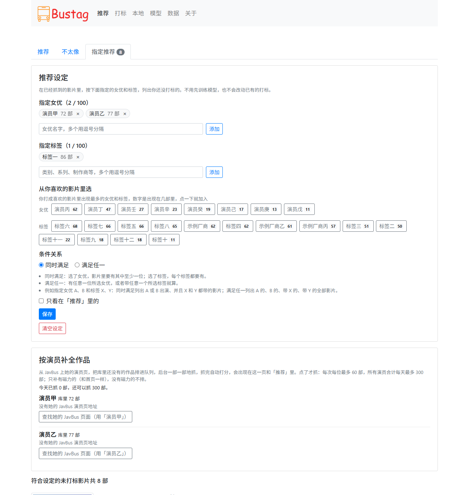

# Bustag（维护版）


给 JavBus 影片打标、训练模型并自动推荐的小工具。原理：定时抓取最新的影片信息，你对影片点"喜欢"或"不喜欢"；打标到一定数量后训练一个模型，它按影片的标签学你的口味，给每部还没打标的影片打一个相似度并从高到低排好，可以先看最像的、跳过大量不喜欢的影片，节约时间。

## 关于这个版本

- 原作者 [gxtrobot](https://github.com/gxtrobot/bustag) 在 2019-10 发布 0.2.1 后停止了维护，原版的爬虫框架（aspider）、依赖版本、网站域名、封面图床和 Docker 镜像都已失效，今天装不上也跑不起来。
- 本仓库（[njwujinyu/bustag](https://github.com/njwujinyu/bustag)）是在原作者 0.2.1 的代码基础上继续维护的版本：重写爬虫、封面改为程序代取、更新依赖和 Docker 镜像，新增了 Windows exe 和自检命令 `check`。0.3.x 只修不加功能；0.4.0 换了推荐用的模型、推荐页改成按相似度排序，加了指定推荐、按演员补全作品、打标页搜索、同番号改选和后台补演员名（每位女优只留一个正式名字，别名另外记），日志写进文件，**默认只允许本机访问**（见[更新记录](#更新记录)）。原有的数据表没有改动，0.2.x 的 `bus.db` 可以直接用；升级后第一次启动会自动整理一次演员数据，整理前先在数据目录里留一份快照。
- 感谢原作者 gxtrobot 的创作，许可证（MIT）保持不变，见 [LICENSE](./LICENSE)。
- 问题请到本仓库的 [Issues](https://github.com/njwujinyu/bustag/issues) 反馈。

**免责声明：本软件仅用于技术学习使用，禁止用于商业用途，使用本软件所造成的后果由使用者承担！**

## 系统功能

- 自动抓取最新影片信息（启动后约 5 秒抓一次，之后按 `interval` 间隔抓取）
- 影片打标（喜欢 / 不喜欢），可以按番号、标题、演员和其他标签搜索；封面由程序代取并缓存
- 基于全部打标数据训练模型；有了模型后，每次抓取完、每次训练完都给所有还没打标的影片打分，按相似度从高到低列出，最像的一部分算"推荐"
- "模型"页用大白话写明模型的效果：喜欢、不喜欢各认对几成，这个数字有多大的误差，还差多少打标
- 指定推荐：指定女优和标签，在已经抓到的影片里列出符合的、还没打标的，不用先训练模型
- 按演员补全作品：在指定推荐页上点一下，从 JavBus 上她的演员页把库里还没有的、有磁力的作品排队抓进来（点了才抓，每次每位最多 60 部，所有女优合计每天最多 300 部）
- 网站上没有写演员的影片，程序在后台到 av-wiki 补演员名（你喜欢的先补）；每位女优只有一个正式名字，读音、罗马字、别名另外记着，搜索和指定推荐时用哪个名字都能找到她
- 手动上传番号、登记本地文件（或 Plex 等服务器上的视频链接）
- 导入别人的 / 旧版本的打标数据库
- Windows 双击运行的 exe，Docker 镜像（linux/amd64 和 linux/arm64，适合 NAS 和服务器）

## 系统截图（隐藏了左边封面图片）

下面的截图是现在这个版本的界面，用的是编造的数据：影片标题、番号、演员和标签的名字都是假的，封面是纯色渐变的占位图，不是真实的影片。

- 推荐页面
  

- 打标页面
  

- 本地文件页面
  

- 上传番号页面（"本地"里的第二个标签页）
  

- 模型页面
  

- 数据页面
  

## 如何运行

启动后在浏览器打开 `http://127.0.0.1:8000`（程序会在日志里打印这个地址）。

**默认只有运行它的这台电脑能打开**（exe 和源码运行时只监听 `127.0.0.1`）。要让同一局域网里的手机、电脑也能访问：打开数据目录里的 `config.ini`，在 `[server]` 一节把 `host` 改成 `0.0.0.0`（旧的 `config.ini` 里没有这一节就在末尾加上两行 `[server]` 和 `host = 0.0.0.0`），重启程序，然后在别的设备上打开 `http://<这台电脑的局域网 IP>:8000`。这个地址程序拿得准时会写在启动日志里；这台电脑有不止一个网络地址时（装了 TUN 模式的代理、VPN、虚拟机时常见）程序不猜，日志里写的是怎么查：在命令行里运行 `ipconfig`，看无线或有线网卡的"IPv4 地址"（Linux 上是 `ip addr`，macOS 上是 `ifconfig`）。`host` 写 `::`（IPv6 的"所有地址"）不支持，要放开请写 `0.0.0.0`；具体的 IPv6 地址（例如 `::1`）可以用。Docker 镜像本来就要从容器外面访问，谁能访问由端口映射决定（见下面 Docker 一节）。

> 程序没有登录功能。放开给局域网以后，这个网络里的任何设备都能打开并修改，**不要在公共网络（公共 Wi-Fi 等）上放开，也不要把 8000 端口映射到公网**。会修改数据的操作（打标、改推荐设定、训练、上传番号、导入）只接受从 bustag 自己的页面提交，你浏览的别的网页偷偷向这里提交表单会被拒绝（403）；这不能代替登录。放在反向代理后面时，代理要保留原来的 `Host` 头（较老的浏览器靠它判断来源）。

同一个数据目录同时只能有一个 bustag 在运行：已经开着一个的时候再启动，后启动的那个会提示"bustag 已经在运行"和它的访问地址，然后退出，直接在浏览器里打开那个地址就行。

### Windows（exe，不用装 Python）

1. 到本仓库的 [Releases](https://github.com/njwujinyu/bustag/releases) 页面下载 `bustag-<版本>-windows-x64.zip`。每次推送代码的构建也能在 [Actions](https://github.com/njwujinyu/bustag/actions) 里对应的运行页底部下载（需要登录 GitHub）。
2. 解压到任意目录（不要放在 `C:\Program Files` 这类需要管理员权限的位置，程序要在 exe 旁边写 `data` 目录）。
3. 双击 `bustag\bustag.exe`。会出现一个黑色的控制台窗口，里面是运行日志，**关掉窗口程序就退出了**。
4. 浏览器打开 `http://127.0.0.1:8000`。

说明：

- 数据（数据库、配置、模型、封面缓存、日志）放在 exe 旁边的 `data` 文件夹。升级时先关掉旧版，把新版解压到新目录，再把旧目录里的 `data` 文件夹复制过去。
- 第一次启动较慢（本机实测约 19 秒，杀毒软件会扫描解压出来的上千个文件），之后 2–3 秒。exe 没有数字签名，Windows 可能弹出"已保护你的电脑"，点"更多信息 → 仍要运行"。
- 窗口里的日志同时写在 `data\logs\bustag.log`，关掉窗口以后还能看。
- 不小心双击了两次：第二个窗口会写"bustag 已经在运行"和访问地址，按回车关掉它就行，第一个不受影响。
- 端口被别的程序占用时窗口里会写明，在命令行里设置 `BUSTAG_PORT` 换一个端口：PowerShell 里 `$env:BUSTAG_PORT = '8001'; .\bustag.exe`，cmd 里 `set BUSTAG_PORT=8001` 后再运行。
- 想用手机或局域网里的其他电脑访问：见上面"默认只有运行它的这台电脑能打开"一段，改 `data\config.ini`。第一次放开时 Windows 防火墙可能会弹出询问，允许"专用网络"即可。
- 出问题时先自检：在 exe 所在的文件夹里打开 PowerShell 或 cmd（在资源管理器的地址栏输入 `cmd` 回车即可），运行 `.\bustag.exe check`。`.\bustag.exe download`、`.\bustag.exe recommend` 和下面"命令行"一节的命令一样；不带参数运行就是启动网页服务。

### Docker（NAS / 服务器，推荐）

镜像是 `ghcr.io/njwujinyu/bustag`，支持 linux/amd64 和 linux/arm64，由 GitHub Actions 构建并推送。

```bash
mkdir bustag && cd bustag
# 把本仓库的 docker-compose.yml 放进来，然后：
docker compose up -d
```

或者直接用 `docker run`：

```bash
# Linux / macOS
docker run -d --name bustag --restart unless-stopped -p 8000:8000 -v "$(pwd)/data:/app/data" ghcr.io/njwujinyu/bustag:latest
# Windows PowerShell
docker run -d --name bustag --restart unless-stopped -p 8000:8000 -v "${PWD}/data:/app/data" ghcr.io/njwujinyu/bustag:latest
```

- `data` 目录保存数据库、配置、模型、封面缓存和日志，**一定要挂载**，否则删除容器就丢数据。第一次启动会自动生成 `data/config.ini`。
- 镜像标签：`latest`（默认分支 / 最新版本）、`0.4.0`、`0.4`（版本号）、`revive` 这样的分支名。
- 时区默认 `Asia/Shanghai`（"今日更新"按这个时区算），要改就设置环境变量 `TZ`。
- 谁能访问：`-p 8000:8000` 这种写法，同一局域网里的设备都能用 `http://<宿主机的 IP>:8000` 打开（程序没有登录保护）；只想让宿主机自己访问时写成 `-p 127.0.0.1:8000:8000`。镜像里设了 `BUSTAG_HOST=0.0.0.0`（容器里只监听 127.0.0.1 的话，映射出来的端口连不进去），不要把它改掉，`config.ini` 的 `[server] host` 在容器里不起作用。
- 8000 被占用时改映射的主机端口，例如 `-p 8080:8000`，然后访问 `http://127.0.0.1:8080`。
- 更新：`docker compose pull && docker compose up -d`。看日志：`docker logs -f bustag`，同样的内容也写在 `data/logs/bustag.log`。自检：`docker exec -it bustag python -m bustag.main check`。
- 同一个 `data` 目录不要挂给两个容器：第二个会因为"bustag 已经在运行"而退出。容器被强行结束后留下的 `data/bustag.lock` 不用管，不影响下次启动。
- 要走代理时在 `data/config.ini` 里写 `proxy`；注意容器里的 `127.0.0.1` 是容器自己，代理在宿主机上就要写宿主机的局域网 IP。

**关于 ghcr.io 镜像的可见性**

GitHub 规定，新发布的容器镜像包**默认是私有的**，此时 `docker pull` 会报 `unauthorized` 或 `denied`。有两种办法：

1. 仓库主人把包改成公开：GitHub 里进入自己的个人主页 → **Packages** 标签 → 点开 `bustag` → 右侧 **Package settings** → 页面最下面 **Danger Zone** → **Change visibility** → 选 **Public** → 输入包名确认。注意公开之后不能再改回私有。第一次工作流成功推送之后才会出现这个包。
2. 保持私有，在要拉镜像的机器上先登录：到 GitHub 的 Settings → Developer settings → Personal access tokens (classic) 创建一个只勾选 `read:packages` 的令牌，然后

   ```bash
   echo <令牌> | docker login ghcr.io -u <GitHub 用户名> --password-stdin
   ```

   再 `docker pull` 或 `docker compose up -d`。

### 从源码运行

需要 Python 3.11 – 3.14，并且 Python 带的 SQLite 要有 JSON 函数（SQLite 3.38 以后都自带；python.org 的安装包、Docker 镜像和 Windows 的 exe 里的都满足，个别较老的 Linux 发行版自带的 Python 用的是系统里旧的 SQLite，没有时程序启动就会说明并退出）。

```bash
git clone https://github.com/njwujinyu/bustag.git
cd bustag
python -m venv .venv
.venv\Scripts\activate          # Linux / macOS：source .venv/bin/activate
pip install -r requirements.txt
python -m bustag.app.index      # 也可以 python bustag/app/index.py
```

数据放在当前目录下的 `data/`（可以用 `BUSTAG_DATA_DIR` 指定别处）。

用 gunicorn 运行时 `-w` **只能是 1**（定时抓取任务在进程内；写成 2 以上时，后面的 worker 拿不到数据目录的锁，启动会失败），请求用 `--threads` 开多个线程处理（数字可以调）。监听地址由 gunicorn 的 `--bind` 决定，`BUSTAG_HOST` 和 `config.ini` 的 `[server] host` 对它不起作用；要让局域网访问就写 `--bind 0.0.0.0:8000`：

```bash
pip install gunicorn
gunicorn -w 1 --threads 8 "bustag.app.index:create_app()" --bind 127.0.0.1:8000
```

不要去掉 `--threads`：不带它时 gunicorn 一次只处理一个请求，下载封面期间整个网站都在排队，单个请求超过 30 秒还会被 gunicorn 重启（连同正在运行的抓取）。

也可以 `pip install .` 之后用 `bustag check`、`bustag download`、`bustag recommend`，作用和下面的 `python -m bustag.main …` 一样。

## 如何使用

按下面的顺序：

1. 打开 **打标** 页，"未打标的"里是新抓到的影片，逐个点"喜欢"或"不喜欢"。打标至少 200 条，并且"喜欢"和"不喜欢"里少的那一类至少 10 条（不到 30 条时能训练，但结果只能参考）；两类都越多越准，尤其是少的那一类。
   - 页面上方有搜索框，"未打标的 / 喜欢 / 不喜欢"三个标签页都能用：输入番号（不分大小写，横线可以不写，`abp001` 能找到 `ABP-001`，只写开头几位也行；整个搜索词是番号才这样找，和别的字写在一起时，只看标题和标签里有没有这一整段字）、标题里的字，或者演员、类别、系列、制作商等标签里的字。翻页和打标之后搜索词还在。
   - 简体和繁体互通：网站上的类别是繁体字，搜"女大学生"能找到"女大學生"，反过来也一样。日文的写法不转换（"気"和"气"是两个字）。
   - 一页看下来都不想要时，点列表下面的"这一页剩下的都不喜欢"：这一页里还不是你亲手打标的影片都标为不喜欢，已经打过标的不动。提交前会问一句、写明几部；没有撤销，标错的到"不喜欢"标签页里逐部改回来。推荐页的两个标签页和指定推荐页的列表下面也有这个按钮。
2. 打开 **模型** 页。按钮上面写着现在有多少条打标、够不够训练（不够时写明还差什么）。点"开始训练"，训练完回到模型页，并且**立刻给所有还没打标的影片重新打分**，页面上方写明"已重新打分 N 部，其中推荐 M 部"。"当前模型数据"用文字说明这个模型怎么样：
   - 用了多少条打标（喜欢、不喜欢各多少）。
   - 交叉验证的结果：把打标分成 5 份，轮流拿 1 份出来检验（模型训练时没见过这一份），重复 10 次，看"喜欢"和"不喜欢"各认对了几成。少的那一类后面的括号是对照：全部猜多的那一类时，它一条也认不出来（0%）。
   - 按相似度排序时，喜欢的影片排在不喜欢的影片前面的概率（乱排是 50%）。
   - 少的那一类只有多少条、所以"认对几成"这个数字上下可能差多少个百分点，以及攒到 50 条还差几条。
   - 模型和"全部猜多的那一类"没有差别时，红色的框里会写明"现在的模型把所有影片都判成喜欢，等于没有筛选"；少的那一类不到 30 条时，黄色的框里写"仅供参考"。检验结果说明模型分得开、只是还没打标的影片几乎都像你喜欢的那些时（比如它们大多是你喜欢的演员的作品），只多一句说明，不算模型有问题。

   训练成功、保存好之后才替换原来的模型；训练失败（比如打标不够）或者保存失败（比如磁盘满）时按钮下面用红字写明原因，"当前模型数据"里仍是原来正在使用的模型（打分照常用它）。训练完打分时如果数据库正被别的程序占着（见常见问题"提示数据库正忙"），新模型照样生效，页面上会写明影片还没有重新打分：下一次抓取后会自动补上，也可以稍后再点一次"开始训练"。
3. 有了模型以后，每次定时抓取结束、每次训练完，程序都给**所有还没有你亲手打标的影片**打分，结果在 **推荐** 页：
   - 每部影片有一个相似度（0–100%，和你喜欢的影片有多像）。相似度最高的 30%（至少 20 部）在"推荐"标签页，其余在"不太像"标签页，两边都按相似度从高到低排。
   - 卡片上写着"相似度 87%"和"因为：…"（把分数拉高最多的一两个标签）；"不太像"里的还写着"拉低分数的：…"。
   - 重新训练之后，以前打过的分全部按新模型重算，影片可能在两个标签页之间换位置。
   - 页面上方显示今日更新和今日推荐的数量（今日推荐是今天新进入"推荐"的影片数）。模型不能用、结果只能参考，或者模型等于没有筛选时，这里会多一行黄色的提示。
4. 在推荐页点"喜欢"或"不喜欢"就是打标，和打标页一样：这部影片变成你的打标数据，离开推荐页，出现在打标页的"喜欢 / 不喜欢"里；点错了到那里改。有了模型以后新抓到的影片马上会被打分，所以打标页的"未打标的"通常是空的，新影片就在推荐页的两个标签页里处理。
5. 积累了更多打标数据后，回 **模型** 页重新训练。"不喜欢"通常比"喜欢"少得多，也更值钱：翻一翻"不太像"，把确实不喜欢的点掉，模型才分得清；一整页都不喜欢时，用列表下面的"这一页剩下的都不喜欢"一次标完。

相似度是模型按你现有的打标估出来的。"喜欢"远多于"不喜欢"时，数字会普遍偏高（大半影片都在 80% 以上也不奇怪），所以"不太像"的头几部也可能写着"相似度 90%"：有参考价值的是先后顺序，不是某一个数字。推荐也只是给**已经抓到**的影片排了个序，不会去网站上找新的；想要某几位女优更多的作品，用指定推荐页上的"按演员补全作品"（见下面）。

### 指定推荐

想只看某几位女优、某几类影片时用它，在 **推荐** 页的第三个标签页（地址是 `/pick`）。它不靠模型，没有训练过模型也能用；列表只在**已经抓到的影片**里筛，也不会改动已有的打标。想把指定的女优在网站上的其他作品抓进来，用设定区下面的"按演员补全作品"（见下一节），那要你点了才会去抓。

截图里的设定是女优「演员甲」「演员乙」、标签「标签一」，条件选"同时满足"：



1. 在"推荐设定"里添加女优和标签，各最多 100 个，每个不超过 200 个字符。输入框里可以一次写多个，用逗号隔开；从表格里复制的一行或几行粘贴进来，会按格子和行拆成几个名字。输入时输入框下面列出库里已有的写法，点一条（或者用上下键选中再按回车）就填进去；女优的别名也会列出来，后面写着是谁的别名。"从你喜欢的影片里选"列出你打成喜欢的影片里出现最多的女优和标签，点一下就加入，一位女优只占一格、显示她的正式名字。每个名字旁边的"×"可以单独去掉，"清空设定"全部去掉（会先问一句）。
2. 名字要和库里的写法完全一样才算，只写一部分不算；英文字母不分大小写，简体和繁体算同一个字：网站上的类别是繁体字，写"女大学生"就能指定到"女大學生"，输入时也能联想到它。日文的写法不转换。每个名字后面显示库里有多少部影片带它，0 部的标成红色，多半是写法不对。"标签"可以是类别，也可以是系列、制作商、发行商、导演或演员的名字。
3. 选条件关系，点"保存"：
   - **同时满足**：选了女优，影片里要有其中至少一位；选了标签，每个标签都要有。
   - **满足任一**：有任意一位所选女优，或者带任意一个所选标签就算。
   - 例如指定女优 A、B 和标签 X、Y："同时满足"列出 A 或 B 出演、并且 X 和 Y 都带的影片；"满足任一"列出 A 的、B 的、带 X 的、带 Y 的全部影片。
4. 下面的列表是符合设定、你还没打标的影片。模型打过分的，卡片上和推荐页一样写着相似度。在"推荐"里的排在最前，然后是模型还没打分的，最后是在"不太像"里的；每一档里相似度高的在前，相似度一样或者都没有分数时新入库的在前。点"喜欢"或"不喜欢"就是打标，和打标页一样；打过标的影片不再出现在这里。列表下面的"这一页剩下的都不喜欢"把这一页一次标完（见上面"如何使用"第 1 步）。标签页上的数字是符合设定的未打标影片数，抓到新影片后会跟着变。
5. 勾选"只看在「推荐」里的"后，只留下同时也在推荐页"推荐"标签页里的；库里还没有模型的推荐结果时这个选项不起作用。

设定保存在数据目录的 `recommend.json` 里，重启后还在。指定女优是按人算的：写她的正式名字、读音、罗马字或任何一个别名（同样不分简繁、不分英文大小写）都是指她，库里的部数、下面的列表、"从你喜欢的影片里选"、按演员补全作品的那一行都算她的全部作品。已选的名字下面写着它指的是谁：选的是别名时写"某某 就是 正式名字（含别名：……）"，选的是正式名字时写"含别名：……"。几位女优共用一个名字（例如读音相同）时，选它就是几位都选，下面会写明是哪几位。网站给演员改过名字时，链到同一个 JavBus 演员页的几个名字也算同一个人；给女优查找到 JavBus 演员页以后（见下一节），那个演员页上的名字也算她。升级前保存的设定照样认，不用重新设。

### 按演员补全作品

定时抓取只读 JavBus 首页上"这几天新出磁力"的影片，你喜欢的女优以前的作品基本抓不到，推荐也就推不出来。指定推荐页的设定区下面有一块"按演员补全作品"，每位已选的女优一行（同一个人的几个名字合成一行；选的是别名时后面括号里写着她的正式名字），写着库里有她几部：

1. **查看**：只读她在 JavBus 上的演员页的第 1 页（1 次请求），这一行写出"JavBus 上有磁力 N 部"；没有磁力的另外写明有几部，不会排进来。
2. **补全最新 60 部**：从她的演员页第 1 页往后翻，把库里还没有的（番号或详情地址已经在库里的、已经排在队里的都跳过）排进抓取队列，一次最多 60 部，然后后台一部一部地抓详情，抓完一批打一次分（有模型时），新影片会出现在"推荐 / 不太像"和指定推荐的列表里。同一部影片出现在几位女优的页面上，只排一次；同一个番号的两条详情各自入库。
3. **继续补全**：上一批抓完以后再点，先看她的第 1 页有没有新片，再从上次停下的地方接着往更早的作品补，这一行写着"往回补到 YYYY-MM-DD 发行的"；已经补到她最早的一部以后只找新片。她还有排队没抓完的时候不能再点（一位同时只排一批）。
4. **取消排队**去掉她还没抓的那些（已经抓到的留在库里），下次继续补全时会重新排到它们。取消以后不再对她发请求：要读的下一页、要抓的下一部，等完两次请求之间的间隔、真正发出去之前会再看一眼她有没有被取消，取消了就不发；请求已经发出去、正在等网站答复的那一个照常处理：抓到的那一部照常入库，读到的那一页不再往队里排。**重试失败的**把网站一时出错没抓到的再排一次。
5. 进度不用刷新：有事在进行时这一块每隔几秒自己更新（浏览器关掉了脚本时刷新页面也能看到）。"关于"页的"后台任务"里也有一行"补全作品"。

只有 av-wiki 名字、没有 JavBus 演员页地址的女优（她的名字是程序从 av-wiki 补来的），以及库里还没有她的影片的名字，这一行是"查找她的 JavBus 页面"：用她的正式名字（为了和同名的人分开编了号的"名字（2）"用不带编号的名字）到 JavBus 按名字找一次（1 次请求）。结果里名字相同的正好一位就直接用它，有几位时列出来让你点一位是她，找不到也会写明。找到以后就能查看、补全了，这个演员页也记成她的 JavBus 演员页，这一行写着"关联的 JavBus 演员页：名字（/star/…）"，那个演员页上的影片也算她的。演员页上的名字是她的一个名字（简体繁体、大小写不同也算）时，库里有了这个演员页的演员（例如补全抓来的影片）以后，她的正式名字换成 JavBus 上的那一个，她的影片跟着换；你点的演员页上是别的名字时，只记下演员页，她的名字和影片都不改。点错了可以点**换一个**（从上次的查找结果里另点一位，没有结果时重新查一次）或者**取消关联**：这个演员页以后不会再自动关联给她，名字已经换成 JavBus 那个的换回她原来的名字（只差简繁、大小写的换回她原来的写法；和那个演员页上的名字一字不差的，像两个同名的人那样写成"名字（2）"），补名写的影片跟着改回来（程序之后再读一次她的女优页核对），这个演员页还没抓的排队也不抓了（还有别的女优也关联着这个演员页时，它排着的影片留着）。

为什么这么保守：JavBus 的 `robots.txt` 不欢迎任何自动抓取（程序的定时抓取本来就不符合它），补全会明显增加请求，所以：

- 只在你点了以后才抓，不会自己去跟进新片。
- 每次每位最多 60 部（`config.ini` 的 `backfill_count`），所有女优加起来每天最多抓 300 部（`backfill_daily`，从每天 0 点算；数的是部，不是请求：同一部当天再试一次，不管是网络出错自动再试，还是你点了"重试失败的"，都不重复算）。到了上限，排队的留到第二天 0 点 1 分以后自动接着抓。上传番号、导入打标库的番号不受这个上限。
- 一部一部地抓，两次请求之间的间隔和定时抓取一样（`delay`），定时抓取、补全、上传番号的下载之间也互相隔开。
- 被网站拦截（HTTP 403 / 429、年龄验证页）立刻停下，这一块和"关于"页写明原因，当天不再自动接着抓。已经排队的影片第二天自动接着抓，想马上继续就点这一块上方黄色提示里的"现在继续"（她还有排队的时候"继续补全"按钮不出现，只能点它）；被拦截的那一刻还没做的也不会再自己去做，第二天也不会：点过"补全"、还没翻到演员页的几位，点过"查看"、还没读第 1 页的几位，点过"查找她的 JavBus 页面"、还没查的几位，她们那一行写着被拦截了，要继续请再点一次对应的按钮；被拦截以后你才点的"查看""查找"照常做一次，不会让排队的影片接着抓。演员页读不到时（连不上、网站出错，或者页面上写着有磁力的影片、却一个影片框也找不到，多半是网站改了版面）只停下这一位并写明原因，不会记成已经补到底，再点才继续。
- 只补有磁力的影片（和首页一样），没有磁力的抓来了也看不了。

一位女优在 JavBus 上常常有几百部，按默认的设置几位常看的女优要几天才能补完，这是有意的。

### 其他页面

- **本地**：登记过本地文件或视频链接的影片，点"播放"按钮会跳转到登记的链接（只支持 http / https 地址，例如 Plex 里的播放地址）。影片信息还没下载到的本地文件（正在下载，或者番号不存在、下载失败）暂不列出，页面上会写明还有几个。
  - **上传番号** 标签页里每行写 `番号` 或 `番号,链接`（链接里可以有逗号），一次最多提交 10 MB（约十万行）。番号不区分大小写，`300MIUM-1506`、`T28-123`、`[FHD]SSIS-001.mp4` 这类写法都能认出来，不带横线的 `abp001` 记成 `ABP-001`。
  - 勾选"全部打标为喜欢"可以批量打标：已经有系统推荐的影片改成你的打标，你自己打过标的保持不变。库里还没有的番号会加入下载队列，后台一个一个地抓，抓完打分。
  - 下载队列记在数据库里，没抓完就关掉程序，下次启动后接着抓。这个标签页下面写着还在排队几个，没抓到的番号逐个列出来（"网站上没有"，或者"失败"和原因）；失败的可以点"再试"，也可以一次全部再试，或者清除这些记录。
- **数据**：导入另一个 bustag 的 `bus.db` 里的用户打标（0.2.x 以前的旧格式也支持）。番号统一成大写，番号不合法或评分不是"喜欢 / 不喜欢"的行跳过；已经有系统推荐的影片改成导入的打标，你自己打过标的保持不变。结果页写明导入了几条（其中几条原来是系统推荐）、几条没有改动、跳过了几条；库里没有的番号会加入同一个下载队列（见上面的"上传番号"）。
- **关于**：免责声明和项目信息；下面的"后台任务"写着定时抓取多久一次、现在是不是正在抓取、上一次的结果和下一次的时间，补全作品在排队几部、今天按演员补全抓了几部和还可以抓几部、上一次的结果，补演员名还有几部影片没有演员（其中喜欢的、在"推荐"里的各几部）、今天向 av-wiki 请求了几次和还可以请求几次、升级后的校正还剩多少、上一轮补到几部、上次失败的原因，以及日志文件在哪里。

## 配置

### config.ini

在数据目录里，第一次启动时自动生成（带中文注释），改完需要**重启程序**才生效。

```ini
# bustag 配置文件。首次启动时自动生成，修改后重启程序生效。

[download]
# JavBus 网址。网站换域名时改这里
root_path = https://www.javbus.com
# 每次抓取最多新增多少部影片
count = 100
# 自动抓取的间隔（秒），10800 秒 = 3 小时
interval = 10800
# 高级选项，一般不用改。需要时去掉行首的 # 再修改：
# 两次请求之间的最小间隔（秒）
# delay = 1.5
# 每次抓取最多翻多少页列表
# max_page = 30
# 按演员补全作品（在"指定推荐"页上点了才抓）：每位演员每次最多补多少部
# backfill_count = 60
# 按演员补全作品：所有演员加起来每天最多抓多少部
# backfill_daily = 300
# 补演员名（到 av-wiki 查没有演员的影片）：每天最多发多少次请求，到了就停到第二天
# avwiki_daily = 200

[options]
# 代理地址，例如 http://127.0.0.1:7890 或 socks5://127.0.0.1:1080
# 留空表示使用系统或环境变量里的代理设置
proxy =

[server]
# 网页服务的监听地址。127.0.0.1：只有这台电脑能打开网页。
# 要让同一局域网里的手机、电脑也能访问，改成 0.0.0.0；程序没有登录保护，不要在公共网络上这样用。
# 设置了环境变量 BUSTAG_HOST 时以环境变量为准
host = 127.0.0.1
```

| 配置项 | 默认值 | 说明 |
|---|---|---|
| `download.root_path` | `https://www.javbus.com` | 网站地址，网站换域名时改这里。已知失效的旧域名（`busdmm.work`、`cdnbus.bid`）启动时会在日志里醒目提示，程序不会自动改你的文件 |
| `download.count` | `100` | 每次抓取最多新增多少部影片（不是请求数），整数，至少 1。初次使用想多抓一些可以临时调大，每部约需 2–4 秒；日常 100 以内就够了 |
| `download.interval` | `10800` | 自动抓取的间隔，单位秒（10800 = 3 小时），整数，至少 60，不建议低于 1800 |
| `download.delay` | `1.5` | 两次请求之间的最小间隔，单位秒，可以有小数，至少 0。别调得太小，太频繁容易被网站拦截，也会给网站带来压力 |
| `download.max_page` | `30` | 每次抓取最多翻多少页列表，整数，至少 1 |
| `download.backfill_count` | `60` | 按演员补全作品时，每位女优点一次最多排进队列多少部，整数，至少 1 |
| `download.backfill_daily` | `300` | 按演员补全作品时，所有女优加起来每天（从 0 点算）最多抓多少部（同一部当天再试不重复算），整数，至少 1。到了上限，排队的留到第二天接着抓。网站不欢迎自动抓取，不建议调大 |
| `download.avwiki_daily` | `200` | 补演员名时每天（从 0 点算）最多向 av-wiki 发多少次请求，搜索和女优页都算，整数，至少 1。到了上限这一轮先停下，第二天接着补；"关于"页写着今天用了多少。没人喜欢的影片每部 1 次，喜欢的影片上每位还没读过女优页的女优另加 1 次 |
| `options.proxy` | 空 | 代理地址，支持 `http://`、`https://`、`socks5://`，例如 `http://127.0.0.1:7890`、`socks5://127.0.0.1:1080`。带用户名密码时写 `http://用户:密码@主机:端口`，密码里的 `%40` 这类转义照原样写；`check` 的输出和日志里密码显示成 `***`，只写了用户名时（有的代理把访问令牌放在这里）用户名也显示成 `***`。留空表示使用系统 / 环境变量里的代理（`HTTP_PROXY`、`HTTPS_PROXY`、`ALL_PROXY`） |
| `server.host` | `127.0.0.1` | 网页服务的监听地址。`127.0.0.1` 只有这台电脑能打开；`0.0.0.0` 同一局域网里的设备也能打开（程序没有登录保护，不要在公共网络上这样用）。0.3.x 生成的 `config.ini` 里没有 `[server]` 这一节，按 `127.0.0.1` 处理，要放开就自己加上。环境变量 `BUSTAG_HOST` 优先于它；Docker 镜像里设了 `BUSTAG_HOST=0.0.0.0`，gunicorn 由 `--bind` 决定，这一项在那两种情况下不起作用。写了不能监听的地址时程序启动只写一行错误就退出；`::` 也不支持（那样只监听 IPv6，要放开请写 `0.0.0.0`） |

一次抓取在这些情况下结束：新增够了 `count` 部；翻到了 `max_page` 页；连续 3 页都没有新影片（说明已经追上）；没有下一页；被网站拦截。

`config.ini` 写错时（例如 `interval = 3h`、某一行不是 `键 = 值`、同一个键写了两遍、文件编码认不出来），程序启动时只写一行错误，说明是哪个文件、第几行或哪个值有问题，然后退出（双击运行的 exe 会等你按回车再关窗口）。改好再启动，或者删掉 `config.ini` 让程序重新生成默认配置。数据目录建不了（例如同名的文件占着）时也是这样。

文件编码：程序先按 UTF-8 读（有没有 BOM 都行），读不了再按系统默认编码读。中文 Windows 的系统编码是 GBK，所以用记事本存成 ANSI 也能用；Linux 和 Docker 里系统编码通常就是 UTF-8，只能用 UTF-8。两种都读不了时（例如存成了 UTF-16，记事本里叫"UTF-16 LE"或"Unicode"）报"文件编码无法识别"。程序自己生成的 `config.ini` 是 UTF-8，最省事的做法是一直用 UTF-8 保存。

### 环境变量

| 变量 | 默认值 | 说明 |
|---|---|---|
| `BUSTAG_DATA_DIR` | exe 旁边的 `data`，源码 / Docker 是当前目录下的 `data` | 数据目录，相对路径按当前目录解析，不存在会自动创建 |
| `BUSTAG_HOST` | 空（Docker 镜像里是 `0.0.0.0`） | 监听地址，优先于 `config.ini` 的 `[server] host`；两处都没有时是 `127.0.0.1`（只有本机能访问）。设成 `0.0.0.0` 让同一局域网里的设备也能访问 |
| `BUSTAG_PORT` | `8000` | 监听端口（1–65535），Docker 里改了端口还要改 `-p` 映射 |
| `BUSTAG_DEBUG` | 空 | 设成 `1` 输出详细日志（DEBUG） |
| `TZ` | Docker 镜像里是 `Asia/Shanghai` | 时区，影响"今日更新 / 今日推荐" |

### 命令行

```bash
python -m bustag.main check        # 自检，出问题先跑这个
python -m bustag.main download     # 立即抓取一次，--count N 指定最多新增多少部
python -m bustag.main recommend    # 用现有模型给所有还没打标的影片重新打分
```

Windows exe 把 `python -m bustag.main` 换成 `.\bustag.exe`，在 exe 所在的文件夹里运行，例如 `.\bustag.exe check`；Docker 里是 `docker exec -it bustag python -m bustag.main check`。

`check` 会逐项打印 ✅ / ⚠️ / ❌ 和建议，有关键项失败时退出码为 1：配置（数据目录、日志文件的位置、`root_path`、代理，代理的密码、只有用户名时的用户名显示成 `***`）→ 连通首页 → 解析影片列表 → 抓一部详情并解析（只打印番号和类别、演员的个数，不打印标题和名字）→ 下载它的封面（不写入缓存）→ 数据库里的影片数和打标数、模型文件能不能用（读得出来、内容对；有问题时的提示和网页"模型"页、`recommend` 的一样）。

这些命令可以在网页服务运行的同时使用（它们不占用数据目录的锁）；它们的输出只在命令行窗口里，不写进日志文件。

`recommend` 做的事和每次抓取结束后的打分一样：给所有还没有你亲手打标的影片打分，重新划分"推荐"和"不太像"，然后打印打了多少部、其中推荐多少部。还没有训练过模型、模型文件读不了或内容不对，或者只有旧版本留下的模型文件时打印原因（不写入任何结果），退出码为 1；没有影片可打分时退出码为 0。

命令和网页服务写的是同一个数据库。写的时候如果数据库正被另一边占着，最多等 30 秒；还等不到就打印一行"数据库正被别的程序占用"，退出码为 1，稍后再运行一次即可。

### 数据目录

```
data/
├── bus.db                影片、标签、打标数据、模型给的分数、女优和她们的别名、下载队列和按演员补全的进度（SQLite，运行时旁边会有 bus.db-wal 和 bus.db-shm）
├── bus-before-actress-upgrade-20261111.db
│                         升级到 0.4.0 后第一次启动时、整理演员数据之前自动做的快照（文件名里是那天的日期），只有升级前补过演员名的库才有
├── config.ini            配置文件
├── recommend.json        指定推荐的设定（指定的女优、标签和条件关系），第一次保存设定时才有
├── bustag.lock           网页服务运行时占用这个数据目录的标记，里面是进程号和访问地址；程序关掉以后留着也不碍事
├── model/
│   └── model.json        训练好的模型：每个标签的权重和训练时的检验结果（文本文件，训练之后才有）
├── logs/
│   └── bustag.log        网页服务的运行日志，和窗口里显示的一样；写满 1 MB 改名为 bustag.log.1，最多留 5 个旧文件
└── covers/               封面缓存，可以随时删除，用到时会重新下载
```

`model` 目录里如果还有 `model.pkl` 和 `label_binarizer.pkl`，那是 0.3.x 和更早的版本训练的模型，现在的版本不再使用（见常见问题"从旧版本升级"），可以删掉。

`bus-before-actress-upgrade-日期.db` 是升级前的 `bus.db` 原样的一份（见常见问题"从旧版本升级"第 6 条）。新版本用了几天、演员名字都正常，就可以删掉；想退回旧版本、又要升级前那样的演员数据时，关掉程序，把它改名成 `bus.db` 换掉原来的（这样做会丢掉升级以后的打标和新抓的影片）。

日志（`logs/`）只有网页服务会写：出了问题先看这里，抓取为什么停了、演员名补到没有、哪个请求出了错、打过哪些标（番号、喜欢还是不喜欢）都在里面。里面只写番号和数量：影片标题、演员和标签的名字、本地文件的地址、代理密码都不会写进去。日志目录不能写（只读、磁盘满）时程序照常运行，只在窗口里提示一次。`logs` 整个目录在程序关掉以后可以删掉（程序开着时正在写的那个文件删不掉）。

备份就是关掉程序后复制整个 `data` 目录。`bus.db` 是普通的 SQLite 文件，可以用 [DB Browser for SQLite](https://sqlitebrowser.org/) 之类的软件打开。

## 常见问题

**抓不到数据 / 页面是空的**

先跑自检（Windows exe：在 exe 所在的文件夹里运行 `.\bustag.exe check`；源码：`python -m bustag.main check`；Docker：`docker exec -it bustag python -m bustag.main check`），按提示处理。常见原因：

- *网站换了域名*：到 `config.ini` 把 `root_path` 改成新地址，重启。
- *网络不通 / 要走代理*：在 `config.ini` 的 `[options]` 里写 `proxy`，或者设置系统 / 环境变量里的代理。
- *被拦截*：日志里会写明原因，例如"被年龄验证页拦截"、"Cloudflare 1010：请求特征被拦截"、"Cloudflare 人机验证页拦截"、HTTP 403 / 429。程序已经按浏览器的方式发请求（桌面浏览器的 User-Agent、简体中文的 `Accept-Language`、年龄验证 cookie），仍被拦截时一般是网络出口（IP）的问题：换个网络或代理，等一阵再试，并且不要把 `delay` 调小。

**封面不显示**

封面由本程序通过 `/cover/<番号>` 代取（带上网站要求的 Referer），第一次显示时下载并缓存到 `data/covers/`。还没缓存的封面要等程序去下载，所以页面上的封面是排着队出来的：一次最多同时取 2 张，从上到下，还没轮到的先显示一块灰色的占位（位置已经留好，下面的按钮不会跟着跳）；缓存过的几乎立刻全部出来。向同一个图片站发的两次封面请求之间还至少隔 0.3 秒（程序另加最多 30% 的随机间隔）：浏览器自己会一下子发好几张，这里让它们一张一张地出去，图片站不会看到一阵同时来的请求，代价是一页 10 张都没缓存的封面要三秒多才出齐、是一张一张出来的（在本机上用一个每张封面要 0.1 秒的假图片站量过：没有这个间隔时 0.6 秒出齐，有间隔时 3.3–3.6 秒；真实的图片站更慢时差别会小一些，缓存过的不受影响）。这个间隔只管封面：抓取、补全、上传番号的请求之间仍然只隔 `delay`，它们和封面互相不等。翻页或离开页面时，没取完的那几张就不取了。浏览器关掉了脚本时封面照常显示，只是不排队。

下载失败时显示"封面加载失败"的占位图，同一部影片 10 分钟内不再重新下载，之后刷新页面会重试。图片站根本连不上（连接失败、超时）时，接下来 1 分钟里这个图片站的其他封面直接显示占位图，不用每张各等一遍。单张封面连接超过 5 秒、读取停顿超过 15 秒就放弃，排队超过 20 秒的这次先显示占位图。旧库里的封面地址（`pics.javcdn.pw`）已经失效，程序显示时会自动换算成能用的地址，不用改库。

**从旧版本升级**

从 0.3.x 升级到 0.4.0：

1. 先关掉旧版本，再启动新版本：两个不要同时用同一个 `data` 目录。0.3.x 不给数据目录上锁，新版本没法知道它在用哪个目录：旧版本还开着、两边又是同一个端口时，新版本不会启动，并提示这个端口上已经有一个 bustag 在运行；两边端口不一样时新版本发现不了，要自己留意。原来的 `data` 目录照旧用（exe 是把它复制到新版的 exe 旁边，Docker 还是原来挂载的目录）。启动时数据库里会自动多建九张表（同番号的其他条目、模型给的分数、补演员名的记录、下载队列、演员页的补全进度、查找到的演员页、后台任务的状态、女优、女优的别名），原有的表结构和你的打标都不动。建表要独占数据库一下：第一次启动时 `bus.db` 如果正被别的程序占着（旧版本还开着、数据库工具开着没保存），程序照常启动，用到新表的页面（指定推荐、关于、打标页的搜索等）写着"新版本要在数据库里加几张表…还没加上"；关掉那个程序以后，表在后台自己建好，后面的升级接着做，不用重启。
2. **默认只有本机能访问了。** 0.3.x 监听 `0.0.0.0`，同一局域网里的设备都能打开；0.4.0 的 exe 和源码运行默认只监听 `127.0.0.1`。原来用手机或别的电脑访问的，在 `data/config.ini` 的末尾加上两行 `[server]` 和 `host = 0.0.0.0`（或者设置环境变量 `BUSTAG_HOST=0.0.0.0`）再启动，就和以前一样。Docker 镜像不受影响。
3. 旧模型（`model/model.pkl` 和 `model/label_binarizer.pkl`）新版本不能用，不用手工处理：打标满足训练条件时（见下一个问题），程序启动后会自动重新训练一次，并给影片重新打分，日志里有说明。刚换好程序文件的第一次启动，这一步可能要几十秒（杀毒软件在扫描新文件），这期间推荐页和"模型"页写着"正在用现有的打标自动重新训练"，稍等片刻再刷新就好，不用自己去点训练。打标不满足训练条件时"模型"页会写明还差什么，补够以后到"模型"页点"开始训练"。两个旧文件之后可以删掉。
4. 第一次打分会把以前的系统推荐按相似度重新划分：原来推荐页"喜欢"里的影片，只有相似度最高的 30% 留在"推荐"，其余移到"不太像"。你亲手打的标不受影响。
5. 没有演员的影片（以前打成喜欢的先补），启动后程序会自己在后台到 av-wiki 补演员名（每轮最多 30 部，每天最多 200 次请求），不用做任何操作；进度在"关于"页。
6. **演员数据会自动整理一次。** 以前 av-wiki 补来的名字是一个名字一条演员标签（一位女优的名字、读音、罗马字、别名各一条），列表里一部影片挂着七八个名字，模型也把每个别名当成一个特征。新版本是每位女优只留一个正式名字挂在影片上，其他名字记成她的别名。升级后第一次启动时程序在后台做这件事：
   - 先在数据目录里把 `bus.db` 原样复制一份（`bus-before-actress-upgrade-日期.db`，见"数据目录"），复制不成（例如磁盘满）就不整理。
   - 整理在一个事务里做完：中途断电、程序被关掉，`bus.db` 还是原来的样子，下次启动重新整理。数据库被别的程序占着时也是这样，原因写在日志和"关于"页上，程序照常能用（只是在整理完之前不去 av-wiki 补演员名）。没做成的，程序一直开着的话第二天补演员名之前自动再试一次（库空着才做，只等几秒，等不到就再等一天），重启程序时也会再试；没做成的那一次不留快照。
   - 只改 av-wiki 补名时写下的演员，你的打标、JavBus 给的演员和其他标签都不动；整理以后每部影片上还是原来那几位女优，只是每位只剩一个名字。个别拿不准的地方要等联网校正之后才对：校正以前，夹在两位女优之间、分不清是哪一位的名字还单独挂着，有的女优会显示成两个名字。
   - 正式名字：她在 JavBus 上有演员标签的就用 JavBus 的那个名字，否则用她在 av-wiki 女优页上的第一个名字；两位女优第一个名字相同时，后一位写成"名字（2）"，不会把两个人并成一个。旧数据里看不出女优页上名字的先后，也有一些名字分不清是哪一位的，这些在整理以后由后台补演员名的任务重新到 av-wiki 查一遍来校正（每部影片搜 1 次，每位女优读 1 次女优页；二十来部影片、三十来位女优约 50 次请求，一两轮就做完，连不上就以后再试；搜不到的影片隔 1 天、7 天各再搜一次，还搜不到才保留整理的结果）；"关于"页写着还剩多少、有几部过几天再查、什么时候做完。
   - 打标够训练、又有升级前训练的模型时，整理完会自动重新训练一次并给影片重新打分（校正做完后再训练一次），日志里有说明。
   - 用旧版本打开整理过的 `bus.db` 也没问题：它看到的是每位女优一个名字，另外几张它不认识的表不影响它。旧版本补名时还是一个名字一条：0.4.0 的早期测试版补名时记下了补过哪几部，换回新版本以后，这期间它这样写下的那几部影片在启动时再整理一次（同样先做快照，同一天已经有一份做成了的快照时，新的一份文件名后面再加上时分秒，原来的快照不动），已经整理好的影片不动，已经有的女优只补上别名；0.3.x 补名时不记这个，换回来以后认不出它写下的名字，不会再整理：那几部影片上的女优还是一个名字一条，数据不丢，只是一位女优显示成几个名字。

从 0.2.x 升级：

1. 把旧的 `bus.db` 放进新版的数据目录（原有的表没变，不用迁移；新版启动时会自动补上后来才有的表）。
2. 如果旧的 `config.ini` 里 `root_path` 是 `busdmm.work`、`cdnbus.bid` 这类旧域名，改成 `https://www.javbus.com`，或者直接删掉旧的 `config.ini` 让程序重新生成。
3. 旧的 `model` 目录和上面"从 0.3.x 升级"的第 3 条一样处理，不需要先删掉；第 2、5 条同样适用。
4. 0.1.x 的旧库表结构不一样，不能直接用，可以在"数据"页导入它的打标数据。

**要多少打标数据才能训练？模型用了什么？效果如何？**

至少 200 条，并且"喜欢"和"不喜欢"里少的那一类至少 10 条；不够时"模型"页会写明是哪一类、还差几条。少的那一类不到 30 条时可以训练，但结果只能参考。

模型是带类别权重的逻辑回归：输入是影片的标签（类别、演员、导演、製作商、發行商、系列，没有用到标题），常见的标签权重低一些、少见的高一些（TF-IDF）；"喜欢"和"不喜欢"的条数常常相差很多，训练时按类别加权，少的那一类不会被淹没。训练时先做交叉验证看效果，再用全部打标训练出最后保存的模型。

效果因人而异，以"模型"页上写的为准，重点看少的那一类（一般是"不喜欢"）认对了几成：接近 0% 说明模型只会把所有影片都猜成另一类，起不到筛选的作用，这时页面上有红色的提示。这个数字靠的打标越少越不准，页面上写着它上下可能差多少个百分点。想让模型更准，最有效的是多标一些少的那一类。

少的那一类只有一二十条时，推荐名单还不稳：多标 1 条"不喜欢"再训练，"推荐"里就可能换掉几部到二十几部（一共才十几条，多 1 条就是多了一大截）。这是正常的，攒到几十条以后会稳下来。

**"不太像"里的影片相似度也很高？**

"推荐"和"不太像"是按名次分的，不是按某个分数线：相似度最高的 30%（至少 20 部）在"推荐"，其余都在"不太像"，所以"不太像"的头几部和"推荐"的最后几部相似度差不多。打标里"喜欢"远多于"不喜欢"时，相似度的数字普遍偏高，这时看先后顺序就好。多标一些"不喜欢"之后重新训练，数字会拉开。

**同一个番号有多条详情**

网站上同一个識別碼可能对应多条详情。第二条的地址在番号后面带发行日期（例如 `GEBB-062_2026-10-31`），入库番号也用这个带日期的写法。首页列表里出现的都会入库。按番号抓取时，程序会再查一次搜索结果，把同一識別碼的其他路径记下来，不把先打开的那一条当成唯一结果。

打标页和本地文件页上，有其他条目时会列出来。首页列表抓来的影片不会自动去查，点影片下面的「查找其他条目」可以当场查一次。点「改选」换成那一条，或者在输入框里贴上正确的详情路径（`/番号` 或 `/番号_日期`）。改选后，原来的喜欢或不喜欢留在你选定的那一条上，被换掉的那一条不再留在喜欢列表里。只影响这一条；抓不到详情时原来的打标不动。

**有些影片没有演员**

JavBus 上有一部分影片本来就没有写演员（每天新抓的影片里大约两成）。程序会到 av-wiki 按番号搜一次，把搜索结果上写着的女优挂到影片上；已经有演员的不覆盖。

- 先后：你喜欢的先补，然后是在"推荐"里的，最后是其余的；同一档里新入库的在前。
- 每位女优只有一个正式名字挂在影片上（她在 JavBus 上有演员标签的用 JavBus 的名字，否则用她在 av-wiki 上的第一个名字），读音、罗马字和别名记成她的别名：搜索、指定推荐时写哪个名字都能找到她，列表里每位只显示一个名字。
- 请求要省：没人喜欢的影片只搜 1 次，用搜索结果上的名字；你喜欢的影片上的女优、你在指定推荐里选了的女优，再打开她的女优页读一次全部名字（每位只读一次）。同一个识别码的两条影片（一条番号后面带发行日期）一轮里只搜一次，结果两条都用。每天最多 200 次请求（`config.ini` 的 `avwiki_daily`），到了就停到第二天。
- 这件事在后台做，不占用你的操作：点"喜欢"、上传番号、导入打标、改选详情时只是登记一下，页面马上回来，几秒到十几秒后演员名才出现（刷新页面可见）。
- 什么时候做：程序启动后、每次抓取结束后、每次有新登记时各做一轮，和抓取、打分排队进行。一轮最多 30 部，剩下的下一轮接着做；两次请求之间的间隔和抓取一样（`delay`）。一轮里给还没打标的影片补到了名字，就接着打一次分。
- 每部影片查过没有、结果如何都记在数据库里：av-wiki 上没有的，隔 1 天再查，还没有就隔 7 天，之后每 30 天查一次（新片的资料往往晚些才有）；网络不通的下一轮再查，一轮里连续 3 次请求失败就先停下，被网站拦截立刻停下，不会一直空转。
- "关于"页的"后台任务"里写着还有几部在等（其中喜欢的、在"推荐"里的各几部）、到现在补到了几部、今天请求了几次、上一轮的结果和上次失败的原因；每一部的结果也在日志里（只有番号和数量）。

**按演员补全停下了 / 抓得很慢**

指定推荐页的"按演员补全作品"和"关于"页都写着原因：

- *今天的额度用完了*：所有女优加起来每天最多抓 300 部（`config.ini` 的 `backfill_daily`），排队的第二天 0 点 1 分以后自动接着抓。补全是一部一部地抓的，每部要几秒（`delay` 加上网站的响应时间），一批 60 部要两三分钟。
- *被网站拦截*：当天不再自动接着抓；已经排队的影片第二天自动继续，想马上继续就点这一块上方黄色提示里的"现在继续"。被拦截的那一刻还没做的（还没翻演员页的、还没查看的、还没查找的）不会自己去做，要再点一次对应的按钮。经常被拦截时不要调大上限、不要调小 `delay`，换个网络或代理，等一阵再试（和"抓不到数据"里说的一样）。
- *某一页读不到*：只停下这一位，这一行写着原因（连不上、网站出错，或者页面上写着有磁力的影片、却一个影片框也找不到，多半是网站改了版面），再点"继续补全"就从停下的地方接着来；只有页面上写着她没有有磁力的影片（0 部）时才算已经补到底。旧版本曾把读不懂的页面记成过"已经补到最后一部"（页面上的有磁力部数比库里和队里已知的多，这一行却写着已经补到最底），升级后第一次启动时程序会自己改回来（只整理这一次），之后点"继续补全"就接着往回补。
- *数据库被别的程序占着*（见上面"提示数据库正忙"）：这一轮没做成时，你点了的补全、查看、查找不会作废，那一行写着在等什么（"等着翻她的演员页…（数据库被别的程序占着，这一轮没做成，约 12:05 自动再试）"，查看是"等着读她的第 1 页…"，查找是"等着查找她的 JavBus 演员页…"），"关于"页的"补全作品"里也写着。不用再点，程序自己接着试：先几秒后连着再来 3 轮，还不行就隔 1 分钟、2 分钟、3 分钟再试，之后一直是每 3 分钟一次；数据库一空出来，最迟约 3 分钟（再加上正在等锁的那一次）就接着做，留着的补全、查看、查找和排着的影片都接着做。数据库被占着的时候，留着的补全、查看、查找和排着的影片不会再对网站发请求（已经在路上的那一个除外）；定时抓取照常去读首页，每个抓取间隔一次。日志里"抓排队的影片没有做成"这件事只写两条警告（头一次没做成一条，改成每隔几分钟再试时一条，同一个原因下不管占着多久、定时抓取撞上几次都是这两条），空出来以后再写一条；定时抓取和它之后的打分自己遇到库忙时各写各的，不算在里面。你在这期间再点同一位的"补全"，提示写着上一次的还留着，这次点击也让程序马上再试一次。数据库被占着的时候点"取消排队"，要等半分钟左右才看到"数据库正忙"的页面，**这次取消没有生效**，留着的补全和排着的影片等数据库空出来还会接着做，要取消就等数据库空出来以后再点一次；数据库空着时点"取消排队"以后留着的补全和排着的影片不再做，被网站拦截以后留着的补全、查看、查找也都不再做。程序在这期间关掉再打开也会接着做。重做会多读一次她的演员页，已经排进队列的不重复排，一次最多仍是 60 部。
- 一位女优有几百部时，一次只补 60 部，要多点几次"继续补全"；她还有排队没抓完的时候按钮不出现。

**想用手机 / 局域网里的其他电脑访问**

默认只有运行 bustag 的这台电脑能打开。在 `config.ini` 里把 `[server]` 的 `host` 改成 `0.0.0.0`（没有这一节就加上），重启后用 `http://<这台电脑的局域网 IP>:8000` 访问。启动日志里会写出这个地址；程序拿不准是哪一个时（装了代理、VPN、虚拟机的电脑）写的是怎么查。详见"如何运行"开头。程序没有登录保护，只在自己家里的网络上这样用。

**提示"bustag 已经在运行"**

同一个数据目录已经有一个 bustag 开着（比如双击了两次 exe，或者上一个窗口还没关）。不用再启动，在浏览器里打开提示里的地址就行；想重启就先关掉原来的那个。程序是被强行结束、崩溃的也没关系，再启动不会被挡住。

**端口被占用 / 想改端口**

设置环境变量 `BUSTAG_PORT`。Docker 里改主机端口即可（`-p 8080:8000`）。端口被占时程序会说明占着它的是谁：是别的程序，换一个端口就行；是另一个 bustag，先确认它用的是不是同一个数据目录，是的话直接用它，不要再开一个。

**提示"数据库正忙"**

别的程序正在写 `bus.db`，bustag 等了好一会儿（设定的是 30 秒，电脑忙的时候实际要更久）还没轮到：多半是另一个 bustag 命令（`download`、`recommend`）正在运行，或者用数据库软件打开了 `bus.db` 而且有没保存的修改。这次操作没有保存，稍后再试一次；把那个程序关掉或保存好就不会再出现。后台的抓取和打分遇到这种情况只在日志里记一行，下一轮照常进行。占着的时间长时，同时在等的网页写操作最多 4 个（程序处理请求的线程一共 8 个，都在干等的话连只看的页面也打不开）：再多的不再等，马上得到同样的提示，写明"已经有好几个操作在等它了"；推荐、打标、模型、关于这些只看的页面照常能打开。

提示里写着"数据库正被别的程序独占着，现在连读都读不了"：`bus.db` 还是老版本留下的样子（新版本还没能把它换成现在的存取方式），这时别的程序（多半是数据库软件正往里写、或者正开着的旧版本 bustag）把整个库锁住了，连只看的页面也打不开。程序不会干等，每个页面马上给出这个提示，日志里也记一行。关掉那个程序（数据库软件里先保存）就好，不用重启 bustag；之后 bustag 第一次打开它时会换成现在的存取方式，以后别的程序写它时只看的页面就照常能打开了。

**日志在哪里**

`data/logs/bustag.log`（exe 是 exe 旁边的 `data\logs\bustag.log`），"关于"页和 `check` 的输出里也写着完整的路径。反馈问题时附上里面相关的几行；日志和 `check` 的输出里没有影片标题和演员、标签的名字，只有番号。

## 更新记录

### 0.4.0

- 推荐有了分数和排序：模型给每部还没打标的影片打一个相似度，推荐页的两个标签页改成"推荐"（相似度最高的 30%，至少 20 部）和"不太像"（其余），都按相似度从高到低排；卡片上写着相似度和影响分数最多的标签。原来模型只说"喜欢 / 不喜欢"，打标里喜欢远多于不喜欢时会把所有影片都判成喜欢，推荐页就成了"没打标的全部影片"。
- 模型从 KNN 换成带类别权重的逻辑回归（标签做 TF-IDF），"不喜欢"很少时也认得出一部分；训练时用交叉验证评估，再用全部打标训练出保存的模型（原来只用四分之三）。训练条件多了一条："喜欢""不喜欢"里少的那一类至少 10 条，不到 30 条时提示仅供参考。
- 训练完立刻给所有没打标的影片重新打分，不用等下一次抓取；每次打分都包括以前打过分的影片，重新训练后旧的结果不会留着。命令行的 `recommend` 也是这样，并打印打了多少部、推荐多少部。
- "模型"页改成用文字说明模型的效果：用了多少条打标，喜欢、不喜欢各认对几成，这个数字的误差有多大，还差多少打标；模型等于"全部猜喜欢"时用红色的提示写明。原来的准确率、覆盖率、综合评分在全部猜喜欢时也接近满分，看不出问题。
- 推荐页的按钮从"正确 / 错误"改成"喜欢 / 不喜欢"，点了就是打标。
- 模型文件改成一个文本文件 `model/model.json`，不再受 scikit-learn 版本升级的影响。0.3.x 和更早的版本训练的 `model.pkl`、`label_binarizer.pkl` 不再使用：升级后第一次启动，打标够训练时会自动重新训练一次并打分。
- 新增"指定推荐"（推荐页的第三个标签页，`/pick`）：指定女优和标签，在已经抓到的影片里列出符合的、还没打标的，可以直接点喜欢或不喜欢。条件可以选"同时满足"或"满足任一"，也可以只看同时在"推荐"里的；没有训练过模型也能用，不改动已有的打标。输入名字时会列出库里已有的写法。设定保存在数据目录的 `recommend.json`。用法见"如何使用"。
- 打标页新增搜索：三个标签页都可以按番号、标题和标签（演员、类别、系列、制作商等）找影片，翻页和打标后搜索词保留。
- 搜索和指定推荐里，简体和繁体算同一个字：网站上的类别是繁体字，输入"女大学生"就能找到、指定到"女大學生"。日文的写法不转换。
- 新增"按演员补全作品"：在指定推荐页上点一下，从 JavBus 上她的演员页把库里还没有的、有磁力的作品排进队列，后台一部一部地抓，一批抓完打一次分；每次每位最多 60 部，所有女优合计每天最多 300 部（`config.ini` 里可以改），可以接着往更早的作品补，也可以取消；被网站拦截立刻停下，当天不再自动继续（排队的影片第二天接着抓，还没翻演员页的要再点一次）。只有 av-wiki 名字的女优可以先按名字查找她的 JavBus 演员页，关联错了可以换一个或者取消关联。用法见"如何使用"。
- 上传番号、导入打标库时要下载的番号记在数据库里（原来只在内存里，没抓完就关掉程序，剩下的就不抓了）：重启后接着抓，抓不到的番号和原因列在"上传番号"页上，失败的可以再试。对同一个网站的请求，不管来自定时抓取、补全还是上传番号的下载，两次之间都隔开 `delay`。
- 新增"这一页剩下的都不喜欢"：推荐页的两个标签页、指定推荐页和打标页"未打标的"列表下面多了这个按钮，把这一页里还不是你亲手打标的影片一次标为不喜欢（提交前会问一句，已经打过标的不动）。
- 同一个番号在网站上有多条详情时可以改选：按番号抓取时记下同一識別碼的其他条目，打标页和本地文件页上列出来，也可以点「查找其他条目」当场查，或者贴上详情路径；改选后原来的打标和本地文件留在选定的那一条上。
- 详情里没有演员的影片，到 av-wiki 按番号补演员名（喜欢的先补，然后是"推荐"里的，再是其余的）；已经有演员的不覆盖。补名字在后台做：点"喜欢"、上传番号、导入打标时页面马上返回，程序启动后、每次抓取后会把所有该补的影片补上；每部影片查过没有、结果如何都有记录，网站上没有的隔 1 天、7 天、30 天再查，网络不通的下一轮再查。没人喜欢的影片只搜 1 次、用搜索结果上的名字，喜欢的和指定推荐里选了的女优才读她的女优页；每天最多 200 次请求（`avwiki_daily`）。"关于"页显示进度。
- 每位女优只有一个正式名字挂在影片上，读音、罗马字、别名记在别名表里：列表、模型和"因为 / 拉低分数的"里每位只出现一次，几位女优共用一个读音时不再被并成一个人。打标页搜索、指定推荐写她的任何一个名字都能找到她，输入联想也列出别名并写明是谁的；"库内 N 部"、符合设定的列表、"从你喜欢的影片里选"、按演员补全作品都按人算。旧版本补来的"一个名字一条演员标签"在升级后第一次启动时自动整理（先做快照，一个事务里做完，做不成的程序开着时第二天自动再试、重启时也再试），定不准的由后台重新查 av-wiki 校正；整理后打标够时自动重新训练（见常见问题"从旧版本升级"第 6 条）。
- 列表页的封面改成排队加载，一次最多同时取 2 张：封面还没缓存时不再占满浏览器的连接，指定推荐页的输入联想不会被拖慢 1–2 秒；翻页时没取完的封面不再占着程序的线程。图片站连不上时，1 分钟内其他封面直接显示占位图。向同一个图片站发的两次封面请求之间至少隔 0.3 秒，一页 10 张没缓存的封面三秒多出齐。
- 运行日志同时写进 `data/logs/bustag.log`（1 MB 一个文件，保留 5 个旧文件），关掉窗口以后还能查；没接住的错误连同出错位置也在里面，每次打标也有一行记录。日志和 `check` 的输出里只写番号和数量，不再写影片标题和演员、标签的名字。"关于"页和 `check` 写明日志文件的位置。
- 同一个数据目录只能启动一个 bustag：已经有一个在运行时，再启动的那个提示"bustag 已经在运行"和访问地址后退出（原来端口被占时建议换端口，照做会有两个程序同时改同一份数据）。端口被占时说明占着它的是另一个 bustag 还是别的程序。
- **行为变化：默认只监听 `127.0.0.1`，只有运行它的这台电脑能打开网页**（0.3.x 默认监听 `0.0.0.0`，没有登录，同一个网络里的设备都能打开并修改）。要和以前一样让局域网访问：在 `config.ini` 里加上 `[server]` 一节、写 `host = 0.0.0.0`，或者设置环境变量 `BUSTAG_HOST=0.0.0.0`。Docker 镜像仍然监听所有地址，由端口映射决定谁能访问。
- 数据库正被别的程序写入时，最多等 30 秒（原来 5 秒）；还等不到，网页给"数据库正忙"的提示、命令行给一行说明，不再是出错页和一长串异常；同时在等的网页写操作最多 4 个，多的马上得到提示，只看的页面不受影响。
- 数据库多了九张表（同番号的其他条目、模型给的分数、补演员名的记录、下载队列、演员页的补全进度、查找到的演员页、后台任务的状态、女优、女优的别名），启动时自动建；原有的表结构没有改动，旧的 `bus.db` 仍然可以直接用，整理过演员数据的库旧版本也能打开。

### 0.3.1

- 修正打标签时 GitHub Release 没有附上 Windows zip 的问题：发布作业取回构建产物时，这个 zip 被当成归档自动解开，找不到要附上的文件，Release 没有创建。现在原样取回 zip，发布前先检查它是单层的、解压后顶层是 `bustag/`。
- 程序功能与 0.3.0 相同。0.3.0 没有 Release 页面（Windows 版请下载 0.3.1），它的 Docker 镜像 `0.3.0` 仍然可以用。

### 0.3.0（维护版第一个版本）

- 抓取：用 requests + BeautifulSoup 重写爬虫，替换已经无法运行的 aspider 和 requests-html；串行、限速、失败自动重试；识别年龄验证页和 Cloudflare 拦截并给出提示；默认地址改为 `https://www.javbus.com`，旧域名启动时提示；新增 `proxy`（http / https / socks5）、`delay`、`max_page` 配置；`count` 改为"新增影片数"。
- 封面：由程序代取并缓存到 `data/covers/`（原来的图床已经失效，网站也有防盗链）。
- 配置：没有 `config.ini` 时自动生成，不再退出；新增数据目录环境变量 `BUSTAG_DATA_DIR`。
- 新增自检命令 `python -m bustag.main check`；Windows exe 带参数运行时也能用这些命令（`bustag.exe check`、`download`、`recommend`），不带参数仍是启动网页服务。
- 网页服务改用 waitress，新增 `BUSTAG_HOST`、`BUSTAG_PORT`，启动时打印访问地址，Docker 里 `docker stop` 能正常退出；修复打标、更正、上传番号、导入打标库等页面在异常输入下的错误。
- 模型：去掉 pandas；数据不足或只有一种标签时给出中文提示；旧版本 scikit-learn 保存的模型读不了时提示重新训练，不再报 500。
- 配置写错（语法、数字超出范围、编码）或数据目录建不了时，启动只写一行中文错误就退出，不再打印一长串异常；代理密码里的 `%` 不再被当成转义；`check` 和日志里的代理密码打码（只有用户名时用户名也打码，代理地址写错时的报错里也是）。
- 模型文件、标签编码器内容不对，或者两个对不上、在当前的 scikit-learn 下不能预测（例如重建 Docker 镜像后 scikit-learn 升了版本）时，推荐、`check`、模型页都给出同样的"需要重新训练"提示，不再打印异常栈；`recommend` 命令失败时退出码为 1。训练改成按钮提交（刷新页面不会再训练一次），训练失败时模型页仍显示正在使用的模型的数据；训练成功后才一起替换两个模型文件（训练出错、磁盘满时原来的模型不变），训练和推荐不会同时进行。
- 推荐结果一次写入，几千部新影片也很快；推荐期间你打了标的影片保留你的打标。训练时没见过的新标签不再每次在控制台打出一长串警告。
- 打标：本地番号页"全部打标为喜欢"和导入打标数据时，已经有系统推荐的影片改成用户打标（原来会被静默跳过），导入结果页写明各类条数；导入时检查番号，不合法的不会拿去请求网站。推荐页的"正确 / 错误"只改还是系统推荐的评分，双击或者在旧页面上再点不会把你的选择翻回去。
- 本地番号识别 `300MIUM-1506`、`T28-123` 这类横线前带数字的番号（原来会认成别的番号）；一次最多可以提交 10 MB；本地文件页的总数和列出的一致，影片信息还没下载到的文件会写明个数；两次导入同时进行时不再互相覆盖。
- 同一个番号的两部影片都能入库（第二部的番号带日期）。
- 封面：图片站连不上时快速失败，失败的封面 10 分钟内不再重试，同一张封面同时只下载一次。
- 网页：错误页改成带导航的中文页面；页面声明为中文；分页下拉框只列附近的页码；页码超过总页数时显示最后一页（处理完最后一页的最后一部不再跳到空页）；会修改数据的请求只接受 bustag 自己页面发出的，别的网页跨站提交返回 403；修正"观看次数"和模型页标题的文字。
- 打包：Docker 镜像和 Windows zip 里带上 LICENSE；gunicorn 命令加上 `--threads 8`。
- 打包：支持 Python 3.11 – 3.14，依赖改为版本范围；Docker 镜像（linux/amd64、linux/arm64）和 Windows exe 由 GitHub Actions 构建；定时抓取完全由程序自己调度，不再用 cron。
- 移除：原 README 里的打赏码、QQ 群、网盘下载和旧 Docker Hub 镜像，仓库里的示例数据库 `data/bus.db`。

### 原作者 gxtrobot 的版本

- 0.2.1（2019-10-12）：修复几个 bug，增加启动错误信息打印。
- 0.2.0（2019-10-07）：数据库结构变化；封面点击放大；手动上传番号和本地文件管理；今日更新和推荐数量；打标数据库导入；logo。
- 0.1.1（2019-09-06）：修复部分 bug；增加 Windows、macOS 绿色版。

## 开发

```bash
pip install -r requirements-dev.txt
python -m pytest        # 离线测试；访问真网站的测试默认跳过，设置 BUSTAG_LIVE_TEST=1 才运行
```

本地构建 Windows exe（需要在 Windows 上）和 Docker 镜像：

```bash
pip install -r requirements.txt "pyinstaller>=6,<7"
pyinstaller --noconfirm bustag.spec    # 产物在 dist/bustag/，双击里面的 bustag.exe
docker build -t bustag:dev .
```

GitHub Actions（`.github/workflows/`）：

| 工作流 | 触发 | 做什么 |
|---|---|---|
| `ci.yml` | 推送到 `master` / `revive`、Pull Request、手动 | Ubuntu 上用 Python 3.11 – 3.14、Windows 上用 3.12 跑 pytest；Linux 上再用 gunicorn（`--threads 8`，检查用的是 gthread worker，数据目录上了锁、日志写进了文件）启动一次做冒烟，测试失败时也照样冒烟 |
| `docker.yml` | 推送到 `master` / `revive`、`v*` 标签、Pull Request（到 `master`）、手动 | 分别构建 amd64 和 arm64 镜像并启动容器冒烟（镜像里有 LICENSE、首页、静态文件、健康检查、时区、`docker stop` 耗时、强行结束后带着留下的锁文件再启动、日志文件），通过后推送双架构镜像到 `ghcr.io/<用户>/bustag`（Pull Request 不推送） |
| `windows.yml` | 推送到 `master` / `revive`、`v*` 标签、Pull Request（到 `master`）、手动 | 用 PyInstaller 构建 exe 并冒烟（首页和静态文件、默认只监听本机、日志文件、同一个数据目录的第二个实例被拒绝、`bustag.exe check`，再用合成的打标数据在 exe 里训练、重启后等首次定时任务推荐完），产物 `bustag-<版本>-windows-x64.zip`（exe 旁边带 LICENSE）；每次运行都会按发布时的方式取回并检查发布用的 zip（只读作业：恰好一个、单层、解压后顶层是 `bustag/`）；`v*` 标签时再创建 GitHub Release 并附上这个 zip |

发布新版本：改 `bustag/__init__.py` 里的版本号并提交，然后 `git tag v0.4.0 && git push origin v0.4.0`（标签必须是 `v<版本号>`）。Release 里会有 exe 压缩包，ghcr.io 里会有对应版本号的镜像。
